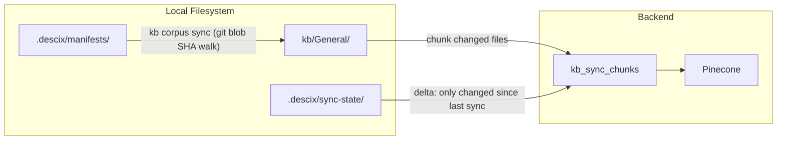

# SDK Architecture Reference

**Status:** Implemented  
**Version:** 2.1  
**Last Updated:** June 2026

This document is the canonical reference for the DeSciX SDK architecture, covering the CLI-centric KB processing pipeline, Drive synchronization, and folder structure conventions.

---

## 1. Architecture Overview

### Core Philosophy

1. **Git as Truth:** The local Git repository is the canonical source for processed text and code. KB content is versioned and synced via corpus manifests tracked in Git.
2. **Drive as Raw Asset Store (server-side only):** Google Drive holds raw assets (PDFs, documents, images). Drive-to-Pinecone processing is a **server-side, PWA-only pipeline** — the CLI never triggers it.
3. **Corpus Manifest as Sync Contract:** `descix kb corpus sync` reads `.descix/manifests/` corpus manifest files, walks Git blob SHAs to detect changes, and syncs only changed chunks to Pinecone.

### Data Flow Summary

**Git Mode (CLI — canonical):**
```
Local Git (markdown + corpus manifest) → kb corpus sync → Backend API → Pinecone
```

**Drive Mode (server-side / PWA-only — never CLI-triggered):**
```
Google Drive → server-side pipeline → GCS → Pinecone
```

---

## 2. Core Components

All core SDK logic resides in `DeSciX_Core/descix-cli/lib/core/`.

### 2.1 Hydrator (`Hydrator.js`)

**Responsibilities:**
- Pull content from Drive to local filesystem (via `descix drive pull`)
- Push staging files to Drive (via `descix drive push`)
- Convert files using Drive's native capabilities (PDF/Image → Google Doc → Markdown)
- Conflict detection and resolution during hydration

**Key Functions:**

| Function | Description |
|----------|-------------|
| `hydrateWorkspace(root, config, driveConfig, options)` | Full workspace setup with folder creation and Drive sync |
| `hydrateApp(config, options)` | Pull entire app from Drive |
| `hydrateKb(config, options)` | Pull and convert KB files from Drive |
| `pushStaging(config, options)` | Upload files from `kb/staging/` to Drive |
| `convertAndSave(driveFile, localDir)` | Convert and save a single file |

**Drive-Native Conversion Logic:**
1. PDF/DOCX/Images: Copy with `convert=true` → Creates temp Google Doc → Export as Markdown → Delete temp doc
2. Google Docs: Export directly as `text/markdown`
3. Google Sheets: Export as `text/csv`
4. Plain text files: Download as-is

### 2.2 Chunker (`Chunker.js`)

**Responsibilities:**
- Chunk documents for RAG embedding
- Support multiple chunking strategies (semantic, sliding window)
- Generate chunk records with metadata for Pinecone

**Key Functions:**

| Function | Description |
|----------|-------------|
| `categorizeFile(fileName, mimeType)` | Detect file type (code/docs/papers/generic) |
| `chunkFile(fileInfo, options)` | Chunk a file based on its type |
| `chunkDocument(content, metadata, rules)` | Markdown-aware section-based chunking |
| `processKb(config, options)` | Process entire KB directory into chunks |
| `loadChunks(config)` | Load all chunks from JSON files |

**Chunking Parameters (defaults):**
- `maxChunkSize`: 2000 characters
- `maxCodeFileSize`: 8000 characters
- `overlapSize`: 500 characters

**Chunking Strategies:**
- **Documents:** Split by Markdown headers (`#`, `##`, `###`) with overlap
- **Code:** Split by logical boundaries (functions, classes, contracts)
- **Generic:** Sliding window with overlap

### 2.3 Syncer (`Syncer.js`)

**Responsibilities:**
- Sync local chunks to Pinecone via backend API
- Compute delta between local and remote chunks
- Manage chunk lifecycle (upsert/delete)

**Key Functions:**

| Function | Description |
|----------|-------------|
| `syncKb(apiClient, config, options)` | Full sync workflow (delta + upsert + delete) |
| `computeChunkDelta(localChunks, remoteIds)` | Compare local vs remote chunks |
| `getRemoteChunkIds(apiClient, communityId, appId, kbId)` | Get existing chunk IDs from Pinecone |
| `upsertChunks(apiClient, ...)` | Push chunks to backend |
| `deleteStaleChunks(apiClient, ...)` | Remove deleted chunks |
| `getSyncStatus(apiClient, config)` | Check sync state |

**Security Note:** The CLI never communicates with Pinecone directly. All chunk operations go through the backend API, which validates metadata and manages Pinecone credentials.

---

## 3. Folder Structure

### Local App Structure

```
[app]/
├── assets/                     # App metadata (bidirectional sync)
│   ├── icon.png
│   ├── app_description.md
│   └── system_instructions.md
├── kb/
│   ├── staging/                # Local files to push to Drive
│   │   └── research.pdf
│   ├── General/                # Text-converted mirror of Drive
│   │   ├── research.md         # Converted from PDF
│   │   └── notes.md            # Converted from Google Doc
│   └── chunks/                 # Processed JSON chunks (Git-tracked)
│       ├── research.chunks.json
│       └── notes.chunks.json
├── site/                       # Static site files (push-only)
│   └── index.html
└── microservice/               # Service code (push-only)
    └── src/index.js
```

### Folder Purposes

| Folder | Sync Direction | Purpose |
|--------|----------------|---------|
| `assets/` | Bidirectional | App metadata (icon, description, instructions) |
| `kb/staging/` | Local → Drive | Raw files waiting to be pushed |
| `kb/General/` | Drive → Local | Text-converted files from Drive |
| `kb/chunks/` | Local only | JSON chunk files for Pinecone sync |
| `site/` | Local → GCS | Static site deployment |
| `microservice/` | Local → GCS | Backend service deployment |

### Configuration Files

**`.descix/workspace.json`** - The **sole** configuration file for CLI operations:

```json
{
  "version": "2.0",
  "communities": {
    "descix": {
      "apps": {
        "agent": {
          "localPath": "descix/agent",
          "kbId": "General",
          "absolutePath": "/path/to/workspace/descix/agent",
          "site": {
            "port": 3000,
            "devCommand": "npm run docs:dev"
          },
          "service": {
            "port": 4001,
            "devCommand": "npm run start"
          }
        }
      }
    }
  },
  "driveConfig": {
    "base_folder_id": "1ABC...",
    "base_folder_name": "DeSciX"
  }
}
```

**Note:** `.descix.app/context.json` files are no longer used. All app configuration is stored in `workspace.json`. The CLI auto-detects app context from the current working directory by matching against registered app paths.

---

## 4. CLI Commands

### 4.1 KB Corpus Sync (`descix kb corpus`) — Canonical Sync Path

`descix kb corpus sync` is the **one canonical KB sync path**. It reads corpus manifests from `.descix/manifests/`, walks Git blob SHAs to detect changed files, chunks only changed content, and upserts/deletes vectors in Pinecone via the backend API.

| Command | Description |
|---------|-------------|
| `descix kb corpus sync -a <app_id>` | Sync KB to Pinecone via corpus manifest (delta, git-aware) |
| `descix kb corpus sync --rebuild` | Reconcile against REMOTE file_ids when the local sync-state is untrustworthy — plain `sync` already purges deleted files (prompts; `--yes` to skip) |
| `descix kb corpus sync --dry-run` | Report what would change without writing |
| `descix kb corpus status -a <app_id>` | Show last sync commit, file counts, chunk counts, and git diff since last sync |
| `descix kb doctor -a <app_id> -k <kb>` | Drift detection: live Pinecone vector count vs local sync state; exits 1 if drift exceeds threshold |

### 4.2 Drive Commands (`descix drive`)

Use `descix drive` to move raw source content between your local staging area and Google Drive. This is a **local-filesystem + Drive operation** — it does not write to Pinecone. After a `drive pull`, run `descix kb corpus sync` to push the converted content to Pinecone.

| Command | Description |
|---------|-------------|
| `descix drive pull` | Download from Drive, convert to text in `kb/General/` |
| `descix drive push` | Upload files from `kb/staging/` to Drive |

### 4.3 Lower-Level KB Commands (`descix kb`)

These commands provide granular control over the local chunking and sync pipeline. Prefer `kb corpus sync` for routine use; use these only when you need step-by-step control.

| Command | Description |
|---------|-------------|
| `descix kb chunk` | Generate JSON chunks from `kb/General/` to `kb/chunks/` |
| `descix kb sync` | Push local chunks to Pinecone via backend API |
| `descix kb build` | Convenience: drive pull → chunk → sync |
| `descix kb status` | Show sync status (local chunk count vs Pinecone) |
| `descix kb list -a <app_id>` | List KBs for an app (names, model overrides, vector counts, last-sync dates) |

### Scaffold Commands

| Command | Description |
|---------|-------------|
| `descix site init` | Copy site template to current app's `site/` folder |
| `descix site upload` | Deploy site to GCS |
| `descix app set-site -a <app_id> --port <port>` | Register the local dev-server port for the app's site (`env.products[].site.port`) |
| `descix microservice init` | Copy microservice template to current app's `microservice/` folder |
| `descix microservice register` | Register microservice with gateway |
| `descix microservice vectorize` | Vectorize README for discovery |

**Note:** Site and microservice commands are Git-based code operations. Drive templates contain content (assets, KB), while site/microservice commands handle code (HTML, JS, Dockerfile, etc.).

### Common Options

| Option | Description |
|--------|-------------|
| `-c, --community <id>` | Community ID (inferred if single) |
| `-a, --app <id>` | App ID (inferred if single) |
| `-k, --kb <id>` | KB name (default: General) |
| `-v, --verbose` | Show detailed output |

### Setup Command

```bash
descix setup [--dev]
```

Flow:
1. Check prerequisites (gcloud CLI, ADC credentials)
2. Open browser for device login + workspace configuration
3. Hydrate local workspace from PWA selection
4. Create folder structure with new KB layout

---

## 5. Backend API

### KB Endpoints

| Endpoint | Method | Description |
|----------|--------|-------------|
| `kb_sync_chunks` | POST | Upsert chunks to Pinecone |
| `kb_get_chunk_ids` | GET | Get existing chunk IDs for delta |
| `kb_delete_chunks` | DELETE | Remove stale chunks |

### `kb_sync_chunks` Request

```json
{
  "community_id": "daita",
  "app_id": "agent",
  "kb_id": "General",
  "chunks": [
    {
      "id": "descix_agent_General_research_0",
      "text": "...",
      "entity_type": "CHUNK",
      "community_id": "daita",
      "app_id": "agent",
      "knowledgebase_name": "General",
      "file_id": "research.md",
      "chunk_id": "0"
    }
  ]
}
```

### Pinecone Integration

The platform uses **Pinecone Integrated Embeddings**:
- Vectorization happens inside Pinecone, not in the backend
- The CLI/backend sends text + metadata only
- Pinecone's `llama-text-embed-v2` model handles embedding
- No local embedding libraries required

**Backend Flow:**
```
CLI → kb_sync_chunks API → pineconeService.upsertChunkRecords() → Pinecone (embeds + stores)
```

### RAG Query

The canonical backend command for querying a KB is `ask_question_to_app`. The CLI surface is `descix chat`.

---

## 6. Data Flows

### Git-Mode KB Sync (Canonical)



### Typical Developer Workflow

1. **Edit:** Add or update markdown files in `kb/General/`
2. **Sync:** `descix kb corpus sync -a <app_id>` — detects changed files via git blob SHAs, chunks them, upserts to Pinecone; deletes vectors for removed files
3. **Verify:** `descix kb corpus status -a <app_id>` or `descix kb doctor -a <app_id> -k General`

### Bringing Raw Drive Content Into Git Mode

1. **Stage:** User adds `paper.pdf` to `kb/staging/`
2. **Push to Drive:** `descix drive push` uploads to Drive `kb/General/`
3. **Pull from Drive:** `descix drive pull` downloads and converts:
   - Sees `paper.pdf` in Drive
   - Copies with `convert=true` → temp Google Doc
   - Exports as Markdown → `kb/General/paper.md`
   - Deletes temp doc
4. **Sync to Pinecone:** `descix kb corpus sync -a <app_id>` picks up the new `paper.md`, chunks it, and upserts

---

## 7. Authentication

### ADC (Application Default Credentials)

The CLI uses Google Cloud ADC for Drive access:

```bash
gcloud auth application-default login \
  --scopes=https://www.googleapis.com/auth/drive.file,https://www.googleapis.com/auth/drive
```

**Verification:**
- `descix setup` checks ADC before proceeding
- `Hydrator` calls `verifyDriveAuth()` before operations

### Backend Authentication

CLI authenticates to backend via device login:
1. `descix login` opens browser
2. User authenticates via Powch
3. CLI receives session token
4. Token stored in `.descix/wallet.json`

---

## 8. Migration Notes

### From `kb/src/` to `kb/staging/`

The v2 architecture renamed `kb/src/` to `kb/staging/` for clarity. The Hydrator includes automatic migration:

```javascript
// If old kb/src/ exists, rename to kb/staging/
const oldSrcDir = path.join(kbBaseDir, 'src');
if (await exists(oldSrcDir)) {
  await rename(oldSrcDir, stagingDir);
}
```

### Git Mode vs Drive Mode

Apps operate in one of two modes, determined by how they are managed:

| Mode | Source of Truth | Versioning | User Type | Tool |
|------|-----------------|------------|-----------|------|
| **Git** | Local Git repo | Git | Developers | CLI (`descix kb corpus sync`) |
| **Drive** | Google Drive | GCS/Firestore | Non-developers | PWA only (server-side pipeline) |

**Important:** The CLI only supports **Git-mode** operations. Drive-mode apps are managed entirely through the PWA with server-side processing. There is no CLI flag to switch modes — if you're using the CLI, you're in Git mode.

Both modes can source content from Google Drive. The difference is:
- **Git mode:** Developer pulls content from Drive via `descix drive pull`, then manages text/chunks locally with Git and syncs via `descix kb corpus sync`
- **Drive mode:** PWA triggers a server-side pipeline (Drive → GCS → Pinecone) automatically — the CLI is never involved

---

## 9. File References

| Component | Path | Description |
|-----------|------|-------------|
| WorkspaceConfig | `DeSciX_Core/descix-cli/lib/workspace-config.js` | Sole configuration class |
| GlobalConfig | `DeSciX_Core/descix-cli/lib/global-config.js` | User-level settings (~/.descix) |
| Hydrator | `DeSciX_Core/descix-cli/lib/core/Hydrator.js` | Drive sync operations |
| Chunker | `DeSciX_Core/descix-cli/lib/core/Chunker.js` | KB chunking |
| Syncer | `DeSciX_Core/descix-cli/lib/core/Syncer.js` | Pinecone sync |
| Corpus Commands | `DeSciX_Core/descix-cli/lib/commands/corpus.js` | Canonical KB corpus sync |
| KB Commands | `DeSciX_Core/descix-cli/lib/commands/kb.js` | Lower-level KB processing |
| Setup Command | `DeSciX_Core/descix-cli/lib/commands/setup.js` | Initial workspace setup |
| Drive ADC | `DeSciX_Core/descix-cli/lib/google-storage-adc.js` | Google Drive API wrapper |
| Backend KB API | `DeSciX_Cloud/services/commandHandlers/appCommands.js` | Server-side processing |
| Pinecone Service | `DeSciX_Cloud/services/pineconeService.js` | Vector database |
| Server Chunking | `DeSciX_Cloud/services/chunkingUtils.js` | Drive-mode chunking |
