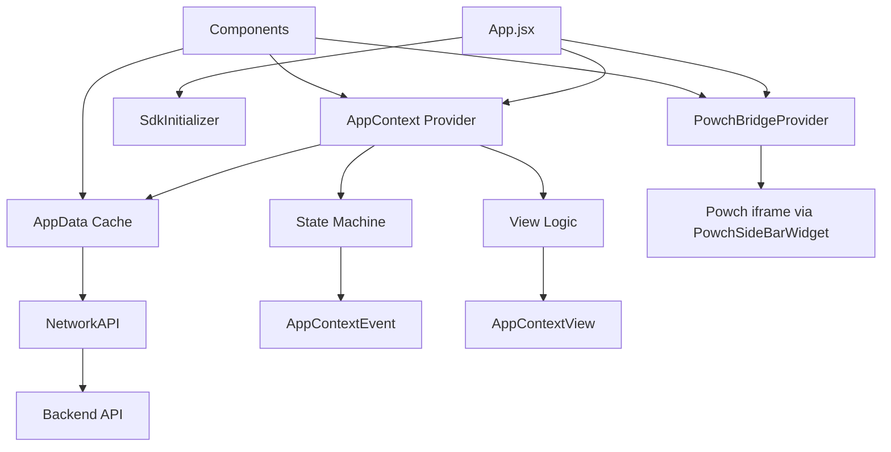

# DeSciX PWA Overview

This guide provides patterns and conventions for the DeSciX PWA frontend. The platform uses React with a centralized state management system based on React Context, an event-driven state machine, and explicit view transition logic.

## Powch in the Ecosystem

Powch is the **DeFi Banking + SSO layer** across DeSciX—one passkey-based identity for PWA, CLI, MCP, and embedded apps. Zero-knowledge, passwordless one-touch login, crypto with credit-card convenience, hardware-wallet-grade security. For the full narrative, see [Powch: DeFi Banking + SSO](../architecture/powch-defi-sso.md).

## Key Principles

- **Powch Authentication**: Passkey-based auth with zero-knowledge architecture
- **Standalone-First**: Platform works standalone with optional Discord embedding
- **Bridge-Based Auth**: DeSciX PWA does **not** use `@powch/react` directly
- **Event-Driven Architecture**: State changes flow through events, not direct mutations
- **View Logic Centralization**: All view transitions go through `viewRouter()` in AppContext

## Authentication with Powch

DeSciX uses Powch for all authentication and wallet operations. **The DeSciX PWA does not use `@powch/react` directly.** It defers all login and wallet flows to Powch via a bridge (postMessage to an embedded Powch iframe).

### Bridge-Based Auth

The PWA uses `PowchBridgeProvider` and `usePowchBridge` from `@descix/app-sdk`. The app shell embeds the Powch PWA in an iframe via `PowchSideBarWidget`. Auth entry points (e.g. `TopNavBar`, `SignInButton`) call `usePowchBridge().login()` with minimal options (session token only). Powch handles identity and wallet; session is updated via `window.DeSciX.loginWithSessionToken`.

```javascript
import { usePowchBridge } from '@descix/app-sdk';

function SignInButton() {
  const bridge = usePowchBridge();
  const handleLogin = async () => {
    const result = await bridge.login({ purpose: 'Sign in to DeSciX' });
    window.DeSciX?.loginWithSessionToken?.(result);
    setAppEvent(AppContextEvent.LOGIN_SUCCESS);
  };
  return <button onClick={handleLogin}>Sign in</button>;
}
```

**Session update:** When Powch completes login, the bridge resolves with `{ sessionInfo, auth_status }`. The caller invokes `window.DeSciX.loginWithSessionToken(result)` to update session state. This is the standard API for embedded apps (CodeSite, etc.) to sync session after Powch returns sessionInfo over the postMessage bridge.

**Components:** `PowchSideBarWidget` (app-sdk) hosts the iframe; `SignInButton` and `TopNavBar` use `usePowchBridge()` for login/wallet actions.

**Note:** `@powch/react` is used only by the Powch PWA and third-party apps. The DeSciX PWA never imports it; all auth UI lives in the Powch iframe.

## Architecture Overview



## Core Principles

1. **Centralized State (AppContext):** Single source of truth for global state
2. **Event-Driven Updates:** State changes triggered via events, not direct mutations
3. **View Logic Centralization:** All view transitions go through `viewRouter()`
4. **Data Caching (AppData):** Persistent and in-memory caching layer
5. **API Abstraction:** All backend calls go through AppData.jsx functions

## AppContext vs AppData

| | AppContext | AppData |
|--|------------|---------|
| **Purpose** | Reactive state (triggers re-renders) | Non-reactive cache |
| **Access** | `useAppContext()` hook | Direct import |
| **Contains** | sessionInfo, loginStatus, currentView, appEvent | myCommunities, myApps, selectedCommunity, API functions |

## Related

- [Powch: DeFi Banking + SSO](../architecture/powch-defi-sso.md) – Full Powch narrative
- [pwa-react-developer-guide](pwa-react-developer-guide.md) – State, viewRouter, single mutex
- [app-shell-and-sdk](../architecture/app-shell-and-sdk.md)
