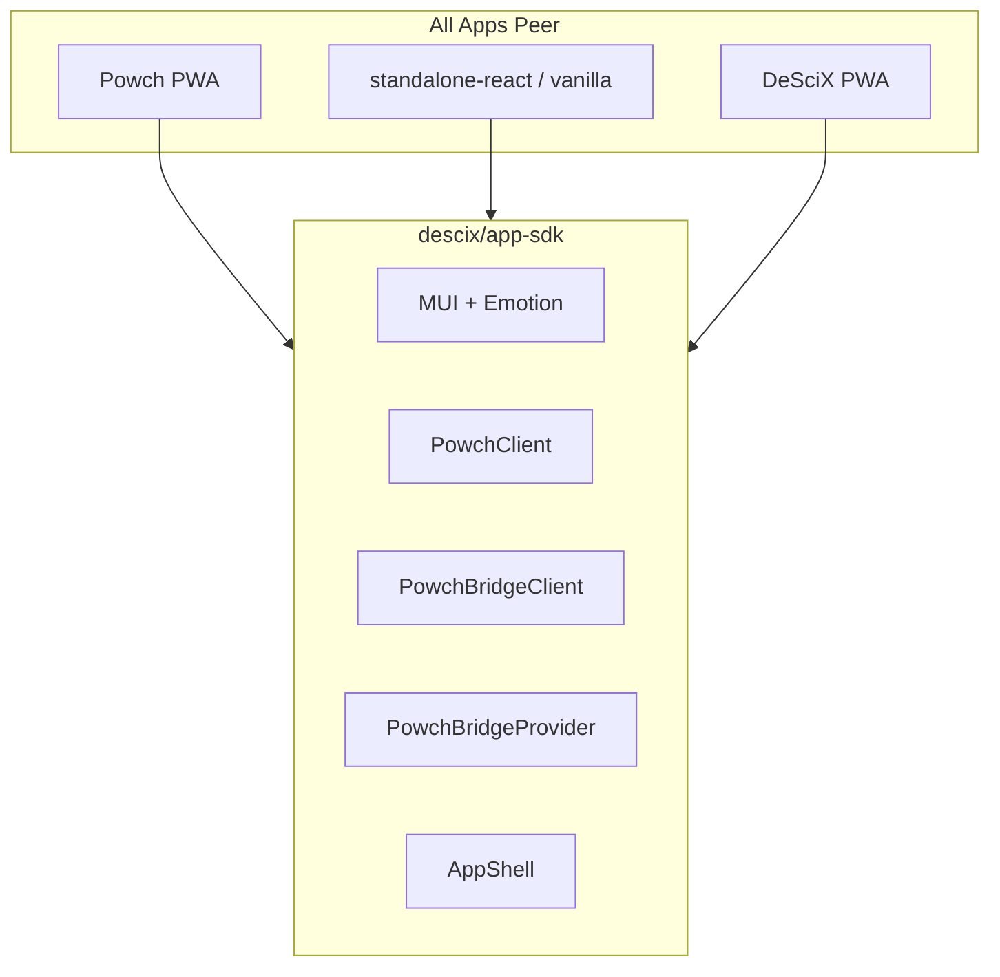

# App Shell and SDK (As-Built)

The `@descix/app-sdk` is the core package for all DeSciX web apps. Every app—DeSciX PWA, Powch PWA, standalone-vanilla, and standalone-react—imports `@descix/app-sdk` and is a first-class standalone app. Standalone is resolved at RUNTIME from a binding served at `/__descix/app-binding.json` on the shell's own origin, so one bundle boots as the store and as your app with no rebuild; an app that builds *itself* standalone declares it at its own mount, `<AppShell appId="my-app" standalone>`.

## Peer Apps Diagram



All apps are peers. App shell is the "OS" for DeSciX apps.

## Build-Time Identity

The shell reads three Vite defines, compiled into its bundle by the build that produced it:

- `__POWCH_APP_URL__`: the Powch origin the shell frames (Powch stays CROSS-origin by design)
- `__API_GATEWAY_URL__`: the API origin the shell calls
- `__WORKSPACE_PRODUCTS__`: map of local apps to their **gateway-origin** URLs — `https://localhost:{gatewayPort}/p/{appId}`, with the shell app at the gateway root; `null` in a production build. Never an app's own dev-server port: apps are always shell-origin when iframed, or `contentWindow` reach throws a cross-origin `SecurityError`.

Under `descix serve` these carry workspace values only in a shell built locally from the shell repo, whose own Vite config computes them from `.descix/workspace.json` with the `@descix/app-sdk/dev` helpers `resolvePowchUrl` and `buildWorkspaceProducts`. A shell proxied from a deployed origin (the default whenever the API origin is remote) arrives pre-built with its deployed values and finds the served app through `GET /__descix/app-binding.json`.

There is no `__STANDALONE_APP_ID__` define; it is deleted platform-wide.

When running standalone, apps define these in `vite.config.js`.

## Auth: Host vs Identity Provider

| App Type | Provider | Auth UI |
|----------|----------|---------|
| DeSciX PWA, standalone | `PowchBridgeProvider` + iframe | Powch iframe via `PowchSideBarWidget` |
| Powch PWA | `PowchAppProvider`, in the Powch app's own React layer (not a published package) | Powch PWA owns its own UI |

**DeSciX PWA does not use Powch's React layer.** It uses `usePowchBridge` and `PowchSideBarWidget` from `@descix/app-sdk`, and its own `SignInButton`. Sign-in sends `bridge.login({ purpose: 'Sign in to DeSciX', registerDeSciX: true })`, a request for the session and no personal fields. The session reaches the shell through `window.DeSciX.loginWithSessionToken(result)` followed by `LOGIN_SUCCESS`: `PowchBridgeClient` makes that call itself for every Powch message that carries a session.

## State Flow

```
INITIALIZING → LOADING → READY
                  ↓
                ERROR
```

- **INITIALIZING**: SdkInitializer bootstrapping
- **LOADING**: Auth in progress, session hydration
- **READY**: Shell ready; app renders full-screen UI
- **ERROR**: Error UI from shell

## Provider Stack

```
ThemeProvider
  └─ CssBaseline
      └─ WagmiProvider
          └─ (appId === 'powch': children only; app provides PowchAppProvider)
          └─ (appId !== 'powch': PowchBridgeProvider)
              └─ AppProvider
                  └─ NetworkLoadingProvider
                      └─ SdkInitializer
                          └─ ErrorBoundary
                              └─ ShellContent
                                  └─ children (app component when READY)
```

## Dev Mode: descix-serve

The primary development entry point is `descix serve`.

**Architecture:**
*   **Gateway:** `descix serve` acts as the reverse proxy and discovery server. Its port resolves `--port` > `env.gateway.port` > built-in `5173` and is printed with its source at startup.
*   **Shell:** the gateway root `/` proxies to the deployed shell at the API origin whenever the API origin is remote (`https://descix.net` on PROD), unless `--site-url` or `env.siteUrl` names another origin. A local shell is served only when the API origin is itself local and `env.gateway.shell` names the shell repo, whose own workspace carries `site.port`.
*   **App:** the shell reads `/__descix/app-binding.json` from the gateway, boots the bound app standalone and frames it same-origin at `/p/{appId}`.
*   **Powch:** a cross-origin frame of the shell. A deployed shell frames the Powch URL compiled into its bundle (`https://powch.descix.net/` in the PROD bundle, `https://powch.dev.descix.net/` in the DEV bundle); `env.powchUrl` takes effect only in a shell the gateway builds locally.

**Routing:**
*   `/` -> the shell origin above.
*   `/p/{appId}` -> the app's `site.static` directory or its `site.port` dev server.
*   API requests (`/apifront`, `/api`, `/mcp`) -> proxied to the resolved API origin.

No port on this page is a fixed value. Every one of them comes from `.descix/workspace.json` and is printed, with its source, by the `descix serve` startup banner.

See [Serve & Launch Modes](../development/serve-and-launch-modes.md).

## Phase 3 Complete

- Phase 1: @descix/app-sdk initialized (complete)
- Phase 2: Powch PWA, standalone-vanilla, standalone-react migrated (complete)
- Phase 3: DeSciX PWA migrated to @descix/app-sdk (complete)

DeSciX PWA mounts `<AppShell appId="app">` and shows a bound app in its `STANDALONE_APP` view through `AppSurfaceWidget`, the same container the store uses for an app opened from the store. Every shell whose `appId` is not `powch` gets `PowchBridgeProvider`; the shell mounts `PowchSideBarWidget`, which holds the Powch iframe.

## Related

- [pwa-overview](../app-sdk/pwa-sdk/pwa-overview.md) – PWA architecture
- [Serve & Launch Modes](../development/serve-and-launch-modes.md) – Local gateway
