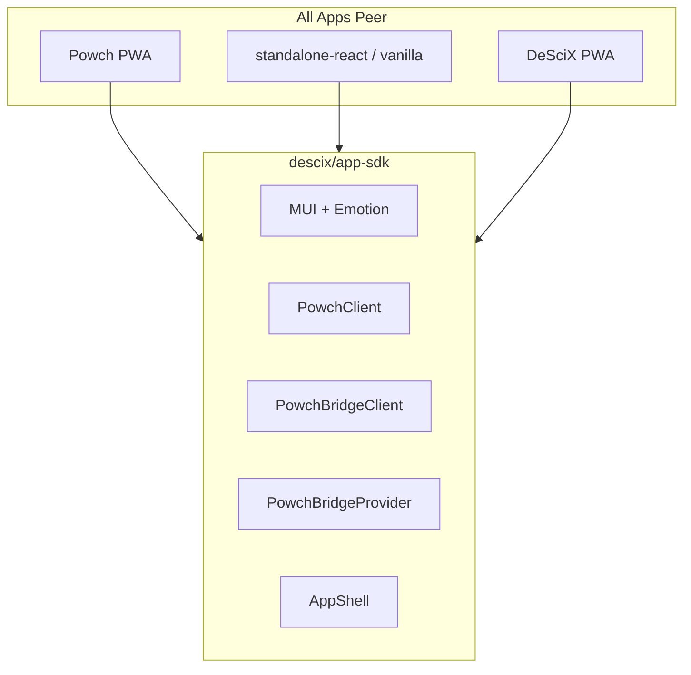

# App Shell and SDK (As-Built)

The `@descix/app-sdk` is the core package for all DeSciX web apps. Every app—DeSciX PWA, Powch PWA, standalone-vanilla, and standalone-react—imports `@descix/app-sdk` and is a first-class standalone app. Standalone is resolved at RUNTIME from a binding served at `/__descix/app-binding.json` on the shell's own origin, so one bundle boots as the store and as your app with no rebuild; an app that builds *itself* standalone declares it at its own mount, `<AppShell appId="my-app" standalone>`.

## Peer Apps Diagram



All apps are peers. App shell is the "OS" for DeSciX apps.

## Build-Time Identity

When running via `descix-serve`, the gateway injects globals from `workspace.json`:

- `__POWCH_APP_URL__`: resolved by `resolvePowchUrl` from `env.powchUrl` (Powch stays CROSS-origin by design)
- `__API_GATEWAY_URL__`: the API origin the gateway resolved (`env.apiUrl`, or the `--api-url` / `--env` override for this run) — printed with its source in the startup banner
- `__WORKSPACE_PRODUCTS__`: map of local apps to their **gateway-origin** URLs — `https://localhost:{gatewayPort}/p/{appId}`, with the platform app at the gateway root. Never an app's own dev-server port: apps are always shell-origin when iframed, or `contentWindow` reach throws a cross-origin `SecurityError`.

There is no `__STANDALONE_APP_ID__` define; it is deleted platform-wide.

When running standalone, apps define these in `vite.config.js`.

## Auth: Host vs Identity Provider

| App Type | Provider | Auth UI |
|----------|----------|---------|
| DeSciX PWA, standalone | `PowchBridgeProvider` + iframe | Powch iframe via `PowchSideBarWidget` |
| Powch PWA | `PowchAppProvider`, in the Powch app's own React layer (not a published package) | Powch PWA owns its own UI |

**DeSciX PWA does not use Powch's React layer.** It uses `usePowchBridge` and `PowchSideBarWidget` from `@descix/app-sdk`, and its own `SignInButton`. Session hydration via `makeCommandRequestJSON` and `POWCH_LOGIN_COMPLETE` event.

## State Flow

```
INITIALIZING → LOADING → READY
                  ↓
                ERROR
```

- **INITIALIZING**: SdkInitializer bootstrapping
- **LOADING**: Auth in progress, session hydration
- **READY**: Shell ready; app renders full-screen UI
- **ERROR**: Error UI from shell

## Provider Stack

```
ThemeProvider
  └─ CssBaseline
      └─ WagmiProvider
          └─ (appId === 'powch': children only; app provides PowchAppProvider)
          └─ (appId !== 'powch': PowchBridgeProvider)
              └─ AppProvider
                  └─ NetworkLoadingProvider
                      └─ SdkInitializer
                          └─ ErrorBoundary
                              └─ ShellContent
                                  └─ children (app component when READY)
```

## Dev Mode: descix-serve

The primary development entry point is `descix serve`.

**Architecture:**
*   **Gateway:** `descix serve` acts as the reverse proxy and discovery server. Its port resolves `--port` > `env.gateway.port` > built-in `5173` and is printed with its source at startup.
*   **Shell:** the platform site at `env.platform.site.port` runs the Store PWA.
*   **Powch:** served from its own origin, `env.powchUrl` — cross-origin from the shell by design.

**Routing:**
*   the gateway origin -> Proxies to the platform site's `env.platform.site.port` (Shell).
*   Shell loads the Powch iframe from `env.powchUrl`.
*   API requests (`/apifront`, `/api`, `/mcp`) -> proxied to the resolved API origin.

No port on this page is a fixed value. Every one of them comes from `.descix/workspace.json` and is printed, with its source, by the `descix serve` startup banner.

See [Serve & Launch Modes](../development/serve-and-launch-modes.md).

## Phase 3 Complete

- Phase 1: @descix/app-sdk initialized (complete)
- Phase 2: Powch PWA, standalone-vanilla, standalone-react migrated (complete)
- Phase 3: DeSciX PWA migrated to @descix/app-sdk (complete)

DeSciX PWA uses AppShell with `StandAloneAppWidget`; host apps use `PowchBridgeProvider` + iframe for auth.

## Related

- [pwa-overview](../app-sdk/pwa-sdk/pwa-overview.md) – PWA architecture
- [Serve & Launch Modes](../development/serve-and-launch-modes.md) – Local gateway
