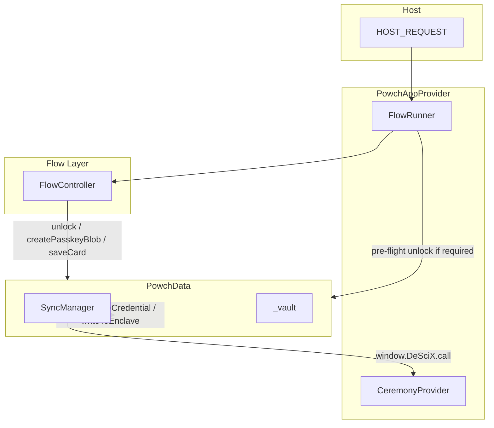

# Powch Architecture

Powch is a **zero-knowledge SSO and self-custody DeFi-Bank** application. The passkey is the identity; email and wallet are stored as **cards** in an encrypted vault. This document describes the architectural paradigms and how they map to the implementation.

---

## 1. Zero-Knowledge Concepts

### What the Server Never Sees

The server never sees:
- PRF output (biometric-derived key material)
- CloudKey (vault encryption key)
- Decrypted vault contents
- Private keys

### What the Passkey Ceremony Yields

A WebAuthn ceremony yields only attestation (create) or assertion (get). The client obtains PRF output from `assertion.clientExtensionResults?.prf?.results?.first` — this never leaves the device. Keys are derived locally.

### What the Backend Receives

| Operation | Backend receives |
|-----------|------------------|
| Registration | credentialId (sanitized as userId), attestation, walletAddress, walletSignature |
| Login | assertion; backend verifies, returns sessionInfo |
| Vault get/put | Opaque encrypted vault blob; access controlled by session (X-DeSciX-User-Id) |

### Implementation Mapping

- **Client:** Powch client-core: `PowchData` SyncManager, `vaultOps` `deriveCloudKeyFromPRF`
- **Backend:** the Powch microservice handles `powch_register_finish`, `powch_login_finish`, `powch_vault_get` and `powch_vault_put`

---

## 2. Passkey as Deterministically Derivable Portable Identity

### User ID = Sanitized CredentialId

The user ID is the WebAuthn credential ID, sanitized for use as a document key (e.g. `Hs-m5YEdCnBhEjbWlZ79VxwmcK4`). No separate "account ID" — the passkey IS the identity.

### CloudKey Derivation

```
CloudKey = HKDF-SHA256(prfOutput, credentialId, "DeSciX-CloudKey-v1")
```

CloudKey is re-derived on every biometric ceremony (read, write, export). It is never stored.

### No Key Object in largeBlob

There is no Key Object or largeBlob storage. CloudKey is derived on demand. Stateless recovery: user can recover on any device with passkey + keychain sync (iCloud, Google).

### One Credential, One Identity

One passkey, one portable identity, one master wallet. The identity syncs with the passkey via the OS.

---

## 3. One-Touch Account Creation and Immediate Crypto Onboarding

### Single Biometric to Crypto

A single WebAuthn create ceremony:
1. Creates the passkey
2. Yields PRF output
3. Client derives CloudKey from PRF + credentialId
4. Master wallet = CloudKey as Ethereum private key

No seed phrases. No separate wallet setup.

### Atomic Registration

`SyncManager.createCredential()`:
1. Performs WebAuthn create
2. Derives CloudKey and master wallet
3. Signs DEFAULT_SIGNATURE_MESSAGE with the wallet
4. Sends attestation + walletAddress + walletSignature to `powch_register_finish`

The backend creates the user, stores the wallet, and returns sessionInfo. After email verification and TOS, the user lands at CONNECTED — no second ceremony.

**Reference:** [prf-derived-master-wallet.md](./detailed/prf-derived-master-wallet.md)

---

## 4. Safety and Convenience: Keychain Sync + Cold Storage

### Keychain Sync

The passkey syncs via the OS (iCloud Keychain, Google Password Manager). CloudKey can be re-derived on any device with the synced passkey. Basic recovery requires no manual seed backup.

### Cold Storage (Paper Backup)

Optional: CloudKey can be exported as a BIP-39 mnemonic for long-term cold storage. Implementation: `cloudKeyToMnemonic()` in Powch client-core's `vaultOps`. If all passkeys are lost, the mnemonic restores the master wallet.

### Vault Deactivation vs Credit Card Deauthorization

Analogous to "deauthorize my card":
- Backend can revoke vault access (e.g. `powch_vault_revoke` or user flag)
- `powch_vault_get` returns 403 or empty when revoked
- Client keys remain on device, but the client cannot fetch the latest vault without server cooperation
- Server stops serving data; user regains control by revoking access on a stolen or lost device

---

## 5. Implementation Overview

### High-Level Flow



- **Host** sends requests via postMessage. The host must open the UI before sending; Powch rejects when its tab is not visible.
- **PowchAppProvider** invokes **FlowRunner** with the appropriate Flow class.
- **FlowRunner** performs pre-flight: if the flow requires vault unlocked and it is locked, calls `PowchData.unlock()` first.
- **FlowController** calls **PowchData** only: `unlock()`, `createPasskeyBlob()`, `saveCard()`, plus getters and signing APIs.
- **PowchData** delegates to **SyncManager**, which uses the injected **CeremonyProvider** for WebAuthn and network.

### SyncManager Operations

| Method | Purpose | Returns |
|--------|---------|---------|
| `read()` | WebAuthn get + PRF; derive CloudKey; fetch vault via `powch_vault_get`; decrypt. No largeBlob. | `{ blob \| null, prfKey, credentialId }` |
| `createCredential()` | WebAuthn create; derive CloudKey + master wallet; send to finishRegistration. | `{ prfKey, credentialId, cloudKey, walletAddress }` |
| `writeToEnclave(vault, credentialId)` | WebAuthn get + PRF; derive CloudKey; encrypt; putVault to cloud. | void |

### CeremonyProvider and Network

SyncManager uses an injected CeremonyProvider. Network calls go through `window.DeSciX.call` (App Shell bridge), not a direct `makeRequest`. The CeremonyProvider includes:
- `beginLogin()`, `finishLogin(assertion)` — login flow
- `beginRegistration()`, `createCredential(options)`, `finishRegistration({ attestation, walletAddress, walletSignature })` — registration
- `beginWalletWrite()`, `authenticate(options, extOptions)` — write ceremony
- `fetchVault()`, `putVault(cloudVault)` — cloud vault get/put

**Vault response shape:** The apiFront wraps responses in `message`. The client uses `vaultResult?.message?.cloudVault ?? vaultResult?.cloudVault` to handle both shapes.

### Command Routing (Cloud vs Powch Microservice)

- **Cloud (powchCommands.js):** `powch_register_finish`, `powch_login_finish` — user creation, session, Firestore
- **Powch service (external):** `powch_register_begin`, `powch_login_begin`, `powch_write_wallet_begin`, `powch_vault_get`, `powch_vault_put` — zero-knowledge WebAuthn and vault storage

### Detailed Implementation

- [data-layer.md](./data-layer.md) — PowchData, SyncManager, vaultOps, CeremonyProvider
- [data-security-architecture.md](./data-security-architecture.md) — Tier model, BlobV3, Card schema, security boundaries
- [flow-controllers.md](./flow-controllers.md) — FlowRunner pre-flight, per-flow requirements
- [developer-guide.md](./developer-guide.md) — Three cases, visibility paradigm, request routing
