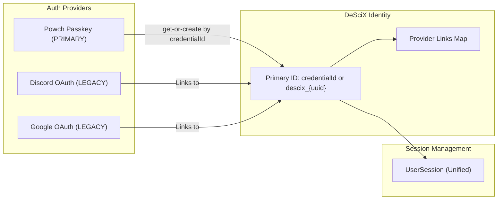
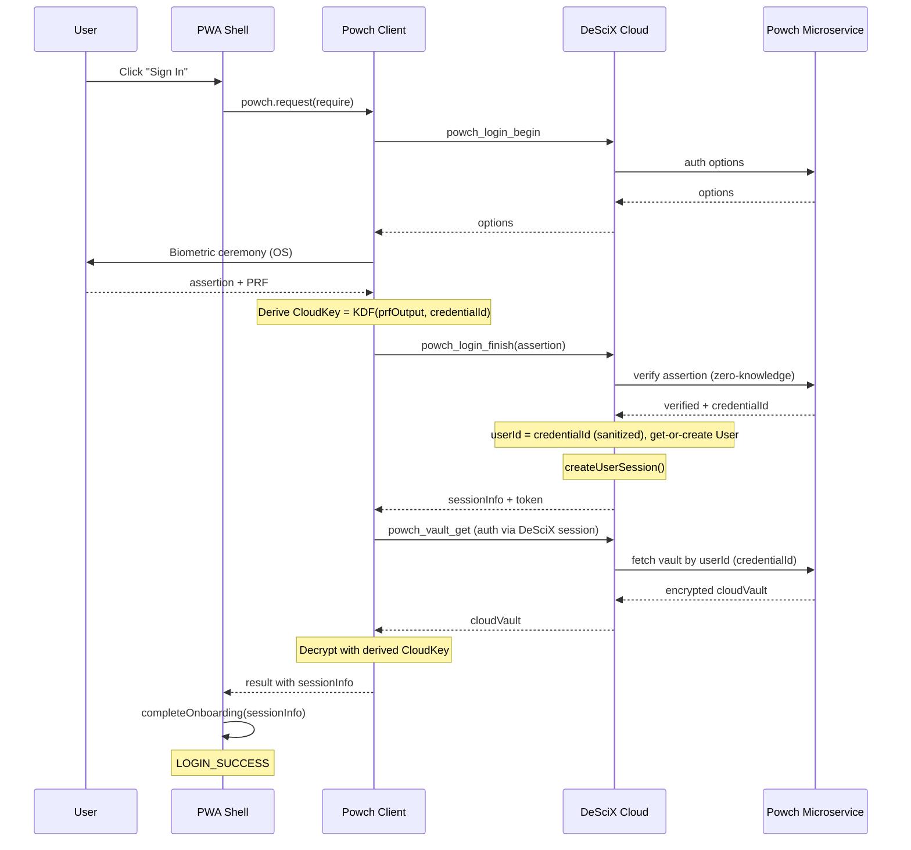
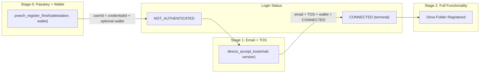
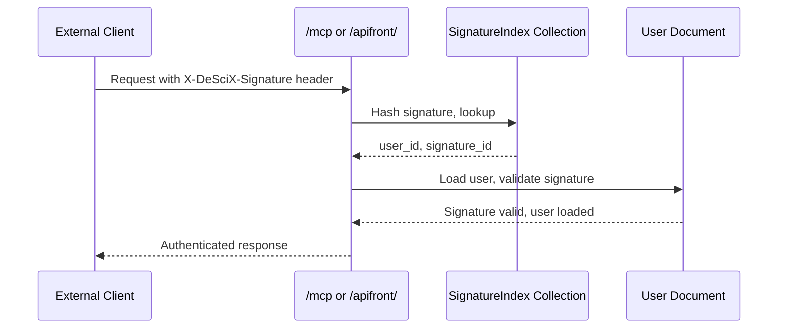

# Authentication Architecture

DeSciX uses **Powch** (zero-knowledge passkey wallet) as the sole authentication and wallet system for web users. Powch provides biometric-gated passkey authentication with a zero-knowledge architecture where the backend never sees the user's PRF output, CloudKey, or private keys.

## Core Principles

1. **Passkey = Identity**: A single passkey is 1:1 with a user account. The user ID is the WebAuthn `credentialId` (stable string; no prefix, no hash). The passkey ceremony atomically creates the user record and DeSciX session at the moment of passkey allocation.
2. **CloudKey is the Master Wallet (Deterministic)**: CloudKey IS the master crypto wallet private key. It is **deterministically derived** from the PRF output via a domain-separated KDF (e.g. `HKDF-SHA256(prfOutput, credentialId, "DeSciX-CloudKey-v1")`). The PRF uses a **system-wide salt** (`powch-prf-v1`) across Powch for consistency. This design enables stateless recovery: the CloudKey can be re-derived on any device with the passkey and keychain sync (iCloud, Google), without relying on largeBlob storage. The passkey's largeBlob is no longer required for CloudKey storage.
   - **One touch to crypto:** Registration sends walletAddress + walletSignature to `powch_register_finish`; `descix_accept_tos` then upgrades to CONNECTED. See [prf-derived-master-wallet.md](./detailed/prf-derived-master-wallet.md).
3. **Backend is Blind to Key Derivation**: The DeSciX backend has no knowledge of the PRF output, CloudKey derivation, or passkey internals. It only knows a WebAuthn assertion was verified and a user document (keyed by credentialId) was created or loaded.
4. **Email is a REQUIRED, Verified KYC Attribute (the passkey remains the identity join key)**: The passkey is 1:1 with the account and IS the identity join key; a verified email is collected and verified after passkey creation but is REQUIRED to reach CONNECTED. Per **CEO-D-2026-07-07-EMAIL-REQUIRED-KYC** (reverses Q-FO-5): DeSciX is a legal contractual DAO with KYC obligations — a verified email is a condition of service, and email-less accounts cannot reach CONNECTED. Consent to SHARE the email with a host remains explicit, but possessing a verified email is mandatory.
5. **Cloud Vault is Opaque**: The backend stores an encrypted cloudVault blob keyed by the user ID (credentialId). It cannot read or interpret the contents.

## Login Status Progression

**Passkey users (primary path):**
```
GUEST → NOT_AUTHENTICATED → CONNECTED   (terminal; entitlements acquired post-connect)
```

**OAuth users (legacy path):**
```
GUEST → AUTHENTICATED → CONNECTED   (terminal; entitlements acquired post-connect)
```

| Status | Trigger | What Exists | Capabilities |
|--------|---------|-------------|--------------|
| **GUEST** | Page load | Nothing | Browse featured communities (read-only) |
| **NOT_AUTHENTICATED** | Any passkey ceremony (register or login) | User record keyed by credentialId, optional wallet, DeSciX session. No email, no TOS. | **Low trust session**: Can call `descix_accept_tos`, `powch_send_verification_code`, `powch_vault_put`, `powch_vault_get`. Cannot use platform features until TOS + email. |
| **AUTHENTICATED** | `descix_accept_tos` (without wallet) | Email verified + TOS accepted, no wallet | Can browse communities, view apps. OAuth users land here. |
| **CONNECTED** | `descix_accept_tos` (with wallet already on record) | Email + TOS + wallet all present | Terminal account state. Full platform access. Zero entitlement is a valid resting state; feature access is an entitlement query (`verify_community_membership` / `verify_subscription` / on-chain `balanceOf`), NOT a login state. |

For passkey users, `NOT_AUTHENTICATED` -> `CONNECTED` happens in a single step because the wallet is registered during `powch_register_finish` and email + TOS are recorded together by `descix_accept_tos`.

Status transitions are one-way upgrades to prevent accidental downgrades from non-auth API responses.

## Identity Model

### Passkey-as-Identity: User ID = credentialId

For Powch (passkey) users, the **user ID is the WebAuthn `credentialId`** (stable string; no prefix, no hash). Sanitized only for Firestore document ID rules (e.g. replace `/` and `+`). This ID:
- Is the Firestore document ID in `UserCache/{userId}` (where userId = sanitized credentialId)
- Is the vault storage key in `PowchVaults/{userId}`
- Is the session key in `UserCache/{userId}/Sessions/{access_token}`

**User document creation** happens at the **moment of passkey allocation** on the backend. User document existence with `User.id === credentialId` (sanitized) is synonymous with Powch passkey allocation. Keychain sync (iCloud, Google) provides SSO across devices.

The **credentialId is determined by the authenticator** (e.g. Secure Enclave) at passkey allocation—the single WebAuthn registration ceremony. It is not chosen by the server or by `powch_register_begin`; it is returned in the attestation response after the user completes the biometric step. CloudKey is derived from PRF output and credentialId via a domain-separated KDF; the master wallet is derived from CloudKey.

Email is NOT the primary ID. It is an optional verified attribute added later (and may be indexed via a future EmailIndex).

### Low Trust Session

After any successful biometric verification (register or login), the backend issues a session for that user ID. Until the user accepts TOS (and optionally verifies email), status is **NOT_AUTHENTICATED**. Allowed commands for this low-trust session:
- `descix_accept_tos`, `powch_send_verification_code`, `powch_verify_code`, `powch_vault_put`, `powch_vault_get`

All other platform features (communities, purchases, etc.) are gated until TOS (and wallet if required) are complete.

### Provider Links

OAuth providers (Discord, Google) attach to a primary user ID via the `provider_links` Map in the User model (legacy path uses `descix_{uuid}`). Powch users have user ID = credentialId (sanitized).



## Authentication Entry Points

| Entry Point | Command(s) | Params | Who Uses It | Session Created By |
|-------------|-----------|--------|-------------|-------------------|
| **Powch Passkey (register)** | `powch_register_finish` | `attestation, walletAddress, walletSignature` | PWA new users | `createUserSession()` in powchCommands |
| **Powch Passkey (login)** | `powch_login_finish` | `assertion` | PWA returning users | `createUserSession()` in powchCommands |
| **Email + TOS** | `descix_accept_tos` | `version, email` | PWA (after passkey) | Creates new session with updated status |
| **Discord OAuth** | `auth_discord` | OAuth code | Discord embedded users | `createUserSession()` in authHandlers |
| **Google OAuth** | `auth_google` | OAuth code | Google OAuth users | `createUserSession()` in authHandlers |
| **API Signature** | `authenticate_by_signature` | `signature` | MCP/CLI/PWA auto-reconnect | `createUserSession()` in authHandlers |
| **Device Code** | `device_complete` | device/user codes | CLI pairing | `createUserSession()` in deviceAuthHandlers |

### Removed Commands

The following "double hop" commands have been removed. Session creation is now atomic within the ceremony finish commands:
- `descix_create_from_powch` (absorbed into `powch_register_finish`)
- `descix_login_with_powch` (absorbed into `powch_login_finish`)
- `descix_link_passkey`
- All `passkey_*` legacy commands (`passkey_reg_begin`, `passkey_reg_finish`, `passkey_reg_begin_new`, `passkey_reg_finish_new`, `passkey_login_begin`, `passkey_login_finish`, `passkey_link_begin`, `passkey_link_finish`)

## Powch as "Software Ledger"

Powch functions like a hardware wallet (Ledger) for web applications:

| Hardware Ledger | Powch (Software Ledger) |
|-----------------|-------------------------|
| Physical device holds keys | Device keychain holds passkey; CloudKey derived from PRF at biometric ceremony |
| Button press approves | Biometric (Face ID/Touch ID) approves |
| USB/Bluetooth connection | Modal UI connection |
| App requests signature | Publisher requests data/signature |
| User confirms on device | User approves in Powch modal |

**Key insight**: The publisher's code NEVER touches private keys. The DeSciX backend NEVER sees the PRF output, CloudKey, or wallet private key. Powch handles all sensitive operations behind the biometric gate.

### Data Boundary

| Data | Where It Lives | Backend Knows? |
|------|---------------|----------------|
| CloudKey (= master wallet PK) | Derived deterministically from PRF via KDF (no storage; re-derived on each biometric ceremony) | No |
| PRF output | Authenticator → client memory only (system-wide salt `powch-prf-v1`; 32 bytes) | No |
| PRF-derived encryption key | Client memory only (during session) | No |
| Encrypted cloudVault | `PowchVaults/{userId}` in Firestore (userId = credentialId) | Stores opaque blob only |
| User ID (= credentialId sanitized) | `UserCache/{userId}` in Firestore | Yes (the user record) |
| Verified email | Added to User doc after verification | Yes (after user consents) |
| Wallet address | Added to User doc at registration (`powch_register_finish`) | Yes (public address only) |

### Cryptographic Model (Deterministic CloudKey)

- **PRF Salt**: System-wide `powch-prf-v1` (used by the WebAuthn PRF extension). Consistent across all Powch operations for predictable derivation and cross-device sync.
- **CloudKey Derivation**: `CloudKey = HKDF-SHA256(prfOutput, credentialId, "DeSciX-CloudKey-v1")`. The PRF output is unique per passkey; credentialId binds the key to the user. No largeBlob storage required.
- **Tier-1/Vault Keys**: Additional keys derived from PRF output via HKDF with domain-specific info strings (e.g. `powch-wallet-v1`).

### Recovery & Device Loss Mitigation

Users without keychain sync (e.g. hardware keys, device-bound passkeys) risk orphaning their identity and wallet if the device is lost.

- **Keychain Sync Detection (Future)**: Future versions anticipate detecting non-synced authenticators in the Powch UX and warning users that their passkey may not recover on a new device. This enables users to add a backup passkey or use a synced provider (iCloud, Google) before it's too late.
- **Paper Backup (Current)**: The current implementation will add a Paper Backup flow. This flow already exists in Powch but needs to be updated to reference the **CloudKey derived from PRF** (rather than a stored key). The recovery phrase encodes the CloudKey so the user can restore the master wallet on any device if all passkeys are lost.

## New User Registration Flow

Registration uses **one** biometric ceremony. The credentialId and PRF result both come from that single WebAuthn create step. `powch_register_finish` is a server-only handler that verifies the attestation and creates the user; it does not trigger a second biometric ceremony.

```mermaid
sequenceDiagram
    participant User
    participant Powch as Powch_Client
    participant Cloud as DeSciX_Cloud
    participant PowchSvc as Powch_Microservice

    User->>Powch: "New User" selected

    Note over Powch: REGISTER_PASSKEY
    Powch->>Cloud: powch_register_begin
    Cloud->>PowchSvc: WebAuthn options
    PowchSvc-->>Cloud: registration options
    Cloud-->>Powch: options

    Note over User,Powch: Single biometric ceremony (credentialId + PRF from authenticator)
    Powch->>User: Biometric ceremony (OS)
    User-->>Powch: attestation + PRF
    Note over Powch: credentialId from attestation; derive CloudKey = KDF(prfOutput, credentialId)
    Note over Powch: Derive wallet from CloudKey; sign message
    Note over Powch: Sign message with wallet PK

    Powch->>Cloud: powch_register_finish(attestation, walletAddress, walletSignature)
    Note over Cloud: Server-only - no second ceremony
    Cloud->>PowchSvc: verify attestation (zero-knowledge)
    PowchSvc-->>Cloud: verified + credentialId
    Note over Cloud: userId = credentialId (sanitized)
    Note over Cloud: Get-or-create User by userId, optional wallet
    Note over Cloud: createUserSession()
    Cloud-->>Powch: sessionInfo (NOT_AUTHENTICATED)

    Note over Powch: Store sessionInfo on AppData (no largeBlob write)

    Note over Powch: COLLECT_EMAIL with TOS checkbox
    Powch->>Cloud: powch_send_verification_code
    Cloud-->>User: Email with code
    User->>Powch: Enter code + check TOS box
    Powch->>Cloud: powch_verify_code
    Cloud-->>Powch: verified

    Powch->>Cloud: descix_accept_tos(email, tos_accepted, version)
    Note over Cloud: Record email + TOS on user
    Cloud-->>Powch: sessionInfo (CONNECTED)

    Note over Powch: Build MASTER_ID card
    Powch->>Cloud: powch_vault_put(cloudVault)
    Cloud->>PowchSvc: store vault by userId (credentialId)

    Note over Powch: FINISH
    Powch-->>User: LOGIN_SUCCESS (CONNECTED)
```

## Returning User Login Flow



## Client-Specific Authentication

### PWA (Web Users)

- **Powch Passkey Authentication** (sole auth method)
  - Passkey creation/login (biometric via OS)
  - Email verification (zero-knowledge, optional, added post-creation)
  - CloudKey derived from PRF + credentialId; master wallet derived from CloudKey
- **Legacy OAuth** (deprecated, for backwards compatibility only)
  - Discord Embedded SDK OAuth
  - Google OAuth (redirect flow)
- Session stored in Firestore (`UserCache/{userId}/Sessions`, userId = credentialId for Powch)

### CLI/MCP

- Device login flow (powered by Powch wallet)
  1. CLI requests device code via `device_request_login`
  2. User visits PWA with device code
  3. User authenticates via Powch (passkey + wallet)
  4. PWA completes login, saves credentials to `.descix/wallet.json`
  5. CLI uses wallet signature for authenticated API calls via `authenticate_by_signature`

### Discord Bot

- Discord OAuth via bot token
- Reaction-based interactions (no explicit login required)

## Progressive Onboarding

DeSciX uses a **progressive onboarding model** where account existence begins at passkey creation, but capabilities unlock as the user completes additional steps. The account is independent of any email address.

### Stage 0: Passkey + Wallet Created (NOT_AUTHENTICATED)

At passkey allocation (`powch_register_finish` or first `powch_login_finish`), the backend get-or-creates a user document keyed by credentialId. User has:
- A user identity (User ID = credentialId, sanitized)
- Optional master wallet address on backend (from `powch_register_finish` with wallet signature)
- A valid DeSciX session token (low trust)
- No verified email, no TOS

### Stage 1: Email + TOS (CONNECTED for passkey users)

`descix_accept_tos` records verified email and TOS acceptance. Since wallet is already on record from Stage 0, passkey users jump directly to CONNECTED. User can:
- Browse communities, view apps
- Make purchases if funded
- Participate in airdrops and token-gated features

### Entitlement acquisition (post-CONNECTED)

CONNECTED is terminal. STAKED and custodial balances are removed (CEO-D-2026-06-14-DROP-CUSTODIAL-ELIMINATE-STAKED). After CONNECTED, a user acquires entitlements via co-equal branches — fiat purchase (`create_stripe_checkout_session`), or crypto purchase (`create_crypto_quote`) — all of which converge on on-chain token holding. Feature access is then an entitlement query (`verify_community_membership` / `verify_subscription`), never a login state.



## API Signature Authentication

DeSciX uses **crypto-native API signatures** as persistent API keys for external clients (MCP servers, ChatGPT plugins, automation scripts). This provides a secure, decentralized alternative to traditional API keys.

### Concept

Wallet signatures serve as persistent API keys:
- **Signature as API Key**: The `signature` field in `wallet.json` doubles as the API key for that client context
- **One-to-One Mapping**: Each `wallet.json` file is assumed to be one-to-one with a client context
- **Crypto-Native**: Uses blockchain wallet signatures instead of server-generated tokens
- **Revocable**: Users can revoke signatures via `revoke_api_signature` command

### SignatureIndex Collection

For efficient authentication, DeSciX maintains a `SignatureIndex` Firestore collection that provides O(1) lookup:

- **Key**: SHA-256 hash of the signature (first 32 characters)
- **Value**: `user_id`, `signature_id`, `wallet_address`, `created_at`, `expires_at`
- **Purpose**: Fast signature-to-user lookup without scanning user documents

### API Commands

- **`generate_api_signature`**: Create a new API signature for MCP/external client access
- **`list_api_signatures`**: List all API signatures for authenticated user
- **`revoke_api_signature`**: Revoke an API signature
- **`authenticate_by_signature`**: Authenticate using an API signature (guest-allowed, O(1) lookup)

### Authentication Flow



### wallet.json Signature Field

The `signature` field in `.descix/wallet.json` serves dual purposes:

1. **Wallet Verification**: Proves ownership of the wallet address
2. **API Key**: Acts as persistent API key for client authentication (used in `authenticate_by_signature`)

## Firestore Collections for Auth

| Collection | Key | Purpose |
|-----------|-----|---------|
| `UserCache` | credentialId (sanitized) or `descix_{uuid}` | User documents (Powch: credentialId; OAuth: descix_ uuid) |
| `UserCache/{id}/Sessions` | `access_token` | Active sessions |
| `WalletIndex` | lowercased wallet address | Wallet address to user lookup |
| `ProviderIndex` | `{provider}_{id}` | OAuth provider to user lookup |
| `SignatureIndex` | SHA-256 hash (32 chars) | API signature to user lookup |
| `PowchVaults` | userId (credentialId sanitized) | Encrypted cloud vault storage |

## Related Documentation

- [prf-derived-master-wallet.md](./detailed/prf-derived-master-wallet.md) - PRF → CloudKey → master wallet: full walkthrough, one-touch registration
- [Powch Documentation](/architecture/powch/) - Complete Powch authentication and wallet architecture
- [Platform Architecture](/architecture/) - Overall platform architecture
- [Economy & Tokenomics](/architecture/economy) - Token economics and IP-IPO
- [Data Models](/architecture/data-models) - User, Community, App, KB models
- [CLI Authentication](/sdk/cli/authentication) - Device login for CLI/MCP
