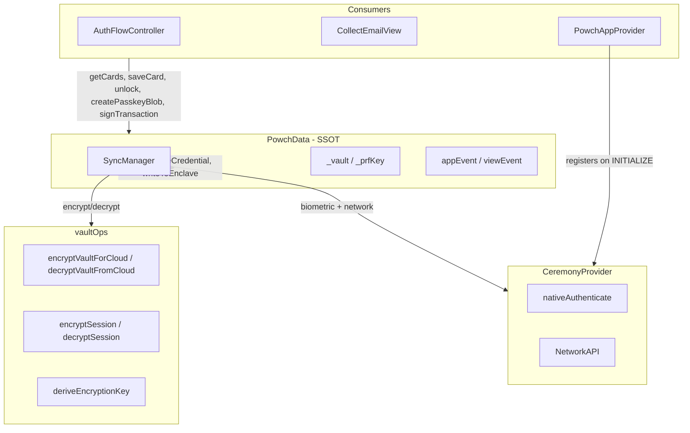

# Powch Data Layer

The data layer is the foundation of Powch's architecture. It manages all state, persistence, and synchronization with the cloud vault (PowchVaults). This document is aligned with [data-security-architecture.md](./data-security-architecture.md): **PowchData is the single entry point**; vault and card terminology apply throughout.

## Architecture Overview



## Layering Rules

1. **vaultOps** (client-core): Pure encrypt/decrypt (blob and session). No state, no network, no WebAuthn.
2. **SyncManager** (inside PowchData): Orchestrates enclave read, create, and write. Exposes `readWithOptions()`, `createCredentialWithCachedOptions()`, `writeToEnclave()`, `getPrfForExport()`, each taking ceremony options fetched before the tap, plus the `begin*Options()` fetchers. Uses vaultOps for encrypt/decrypt. Delegates biometric ceremonies to an injected CeremonyProvider. Owns vault timeout.
3. **PowchData**: SSOT. Exposes cards, `unlockWithOptions()`, `createPasskeyBlobWithCachedOptions()`, `saveCards()` / `saveCard()`, signing, resolveAddress. Hosts SyncManager. Consumers never call vaultOps or SyncManager directly.
4. **PowchAppProvider**: CeremonyProvider, view/event handling. Registers as CeremonyProvider on mount.

---

## PowchData - Active Data Manager

**Location:** client-core, `PowchData` module

PowchData is a static class (no instances) that serves as the Single Source of Truth for all Powch state. It combines in-memory vault state with enclave sync via SyncManager and uses vaultOps for all blob/session crypto.

### Current API (summary)

| Method / area | Purpose |
|---------------|---------|
| `initialize()` | Load credentialId; set empty _vault and _tier3. No decrypt. |
| `beginLoginOptions()` | Fetches the sign-in options (powch_login_begin) before the tap. |
| `unlockWithOptions(options)` | Calls SyncManager.readWithOptions(options) — navigator.credentials.get() is its first await, so call it synchronously from the tap; hydrates _vault and _tier3 (or empty if blob is null). Sets credentialId, _prfKey. Emits VAULT_UNLOCKED. |
| `createPasskeyBlobWithCachedOptions(options, data)` | Calls SyncManager.createCredentialWithCachedOptions(options) — navigator.credentials.create() is its first await, so call it from the New-account tap with options from `beginRegistrationOptions()`; sets credentialId, _prfKey, empty _vault and _tier3. Emits VAULT_UNLOCKED. For new users. |
| `lock()`, `reset()` | Clear _prfKey, _vault, _tier3; reset clears credentialId and Tier 3 storage. |
| `getCards(type?)`, `saveCards(cards, options)`, `saveCard(card, options)`, `removeCard(cardOrId, options)` | Tier 1/2 cards from _vault. A write re-encrypts and writes via SyncManager in ONE passkey ceremony; `options` come from `beginWriteOptions()`, fetched before the tap. |
| `getTier3Cards(type?)`, `saveTier3Card(card)` | Tier 3 cards and consent (Tier3Store). |
| `resolveAddress(address)` | Returns `{ walletId: cardId, keyIndex }` or null. |
| `signTransaction(cardId, txData, makeRequest)` | Sign using cached _prfKey when unlocked. Same pattern: `signMessage`, `signTypedData`. |
| Accessors | `credentialId`, `isUnlocked`, `hasCredential`, `email`, `displayAddress`, `isAuthenticated`, `selectedWalletId`, `appState`, etc. |
| Site consent | `getSites(origin?)`, `getSiteSettings(origin)`, `setSiteSettings(origin, settings)`, `removeSite(origin)`, `clearStoredSession(origin)`. |
| `completeAuth(result)` | Post-auth completion; sets credentialId, appState, clears flowData. |

### Persisted State

| Property | Persistence | Notes |
|----------|-------------|-------|
| `credentialId` | localStorage | WebAuthn credential ID |
| Tier 3 (cards, activeCards, siteConsent) | localStorage `enc_powch_t3` | Encrypted via vaultOps (encryptSession/decryptSession). Tier3Store. |

### Ephemeral State

In-memory only; cleared on `lock()` / `reset()`:

- `_prfKey` - Cached PRF-derived key for unlock period
- `_vault` - PowchVault (BlobV3); empty when locked
- `_tier3` - Tier3Store; empty when locked
- `appState`, `flowState`, `currentTab`, `menuOpen`, `error`, `visualState`, `flowData`, etc.

### Event System

PowchData emits events that PowchAppProvider consumes via `appEvent` and `viewEvent`. PowchAppProvider syncs these into React state with a single `_onEvent` callback.

---

## SyncManager

The SyncManager is a class instantiated as `PowchData.sync`. Its ceremonies take options fetched before the tap and run the WebAuthn call as their first await: **readWithOptions(options)** (WebAuthn get + PRF; fetch vault from cloud, decrypt with CloudKey; returns `{ blob | null, prfKey, credentialId }`), **createCredentialWithCachedOptions(options, data)** (WebAuthn create for new passkeys; derives CloudKey from PRF + credentialId; returns `{ prfKey, credentialId, cloudKey, walletAddress }`), **writeToEnclave(vault, credentialId, options)** (WebAuthn get + PRF; encrypt vault with CloudKey, putVault to cloud) and **getPrfForExport(options)** (paper backup). PowchData calls these; flows never call SyncManager directly. For full ceremony and flow detail, see [architecture.md](./architecture.md).

### CeremonyProvider Injection

PowchAppProvider registers as the CeremonyProvider on INITIALIZE:

```javascript
PowchData.sync.setCeremonyProvider({
  authenticate: (options, extOptions) => nativeAuthenticate(options, extOptions),
  beginWalletWrite: () => NetworkAPI.beginWalletWrite(),
  finishLogin: (assertion) => NetworkAPI.finishLogin(assertion),
  fetchVault: () => NetworkAPI.fetchVault(),
  putVault: (cloudVault) => NetworkAPI.putVault(cloudVault),
  beginLogin: () => NetworkAPI.beginLogin(),
  beginRegistration: () => NetworkAPI.beginRegistration(),
  createCredential: (options) => nativeRegister(options),
  finishRegistration: (payload) => NetworkAPI.finishRegistration(payload),
});
```

Network calls go through `window.DeSciX.call` (App Shell bridge). This abstraction allows SyncManager to trigger biometric ceremonies without direct WebAuthn dependencies.

**Vault response shape:** The apiFront wraps responses in `message`. The client uses `vaultResult?.message?.cloudVault ?? vaultResult?.cloudVault` to handle both shapes.

### Vault Timeout

The SyncManager owns the vault timeout (previously in PowchAppProvider):

```javascript
// Start 15-minute vault timeout
PowchData.sync.startVaultTimeout();

// Clear on logout or explicit lock
PowchData.sync.clearVaultTimeout();
```

When the timeout fires, it calls `PowchData.lock()`, which emits `PowchAppEvent.VAULT_LOCKED` once. The shell session is not touched.

SyncManager is used by PowchData for all enclave I/O: unlock uses `readWithOptions()`, new users use `createCredentialWithCachedOptions()`, card writes use `writeToEnclave()` and the paper backup uses `getPrfForExport()`, each with options fetched before the tap. See [architecture.md](./architecture.md) and [data-security-architecture.md](./data-security-architecture.md) §5.

**completeAuth(result)** (PowchData): Sets credentialId if provided, updates appState, clears flowData and error.

---

## vaultOps - Vault Blob and Tier 1 / Tier 3 Crypto

**Location:** client-core, `vaultOps` module

The blob is the vault (in-memory structure encrypted for cloud storage). vaultOps encapsulates securing the blob and Tier 1 contents. Two layers: (1) vault blob encryption for cloud (encryptVaultForCloud / decryptVaultFromCloud); (2) Tier 1 field encryption within the vault (e.g. crypto wallet private key in a card). vaultOps uses key derivation (deriveCloudKeyFromPRF, deriveEncryptionKey) and cipher operations; scheme-level helpers live in crypto.js. No state, no network, no WebAuthn.

### Vault blob (cloud)

- `encryptVaultForCloud(vaultBlob, cloudKey)` - Encrypt vault for cloud storage.
- `decryptVaultFromCloud(encryptedBlob, cloudKey)` - Decrypt cloud vault.
- `deriveCloudKeyFromPRF(prfOutput, credentialId)` - Derive CloudKey for vault encryption.
- `deriveEncryptionKey(prfOutput)` - Derive CryptoKey from PRF output.

### Tier 1 (within vault)

- `encryptPrivateKey(privateKey, prfOutput)` / `decryptPrivateKey(encryptedKey, prfOutput)` - Encrypt/decrypt card secrets (e.g. CRYPTO_WALLET private key) stored inside the vault blob.

### Session (Tier 3)

- `encryptSession(plaintext, prfKey)` / `decryptSession(ciphertext, prfKey)` - Tier3Store load/save; distinct info string from blob.

Signing is exposed by PowchData (`signTransaction`, `signMessage`, `signTypedData`) and implemented via `transactionSigner.js` using the cached `_prfKey` when the vault is unlocked.

---

## Constants

Exported from PowchData and re-exported by `PowchAppProvider` in Powch's React layer:

```javascript
// App states
APP_STATES.LOCKED
APP_STATES.VAULT_UNLOCKED

// Flow states
FLOW_STATES.IDLE
FLOW_STATES.AUTH_MAIN
FLOW_STATES.AUTH_CREATE
// ... etc

// Tab IDs
TAB_IDS.CARDS
TAB_IDS.PORTFOLIO
TAB_IDS.ACTIVITY
// ... etc

// Event types
PowchAppEvent.INITIALIZE
PowchAppEvent.LOGIN_SUCCESS
// ... etc

PowchViewEvent.CHANGE_TAB
PowchViewEvent.SET_FLOW_STATE
// ... etc
```

---

## File Map

All modules are in Powch's client-core layer (not a published package).

| Concern | Module |
|---------|--------|
| Data manager + SyncManager (SSOT) | `PowchData` |
| Blob and session encrypt/decrypt | `vaultOps` |
| Transaction signing | `transactionSigner` |
| WebAuthn operations | `webauthn` |
| BlobV3 and card container | `PowchVault` model |
| Card model and types | `Card` model |
| Tier 3 encrypted store | `Tier3Store` model |
| Core exports | client-core's entry module |
