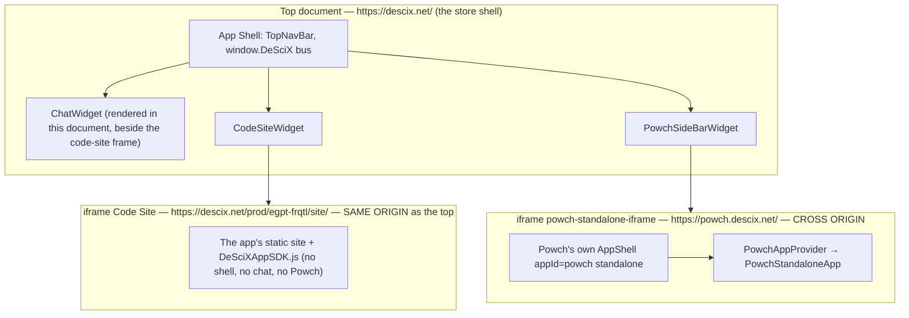
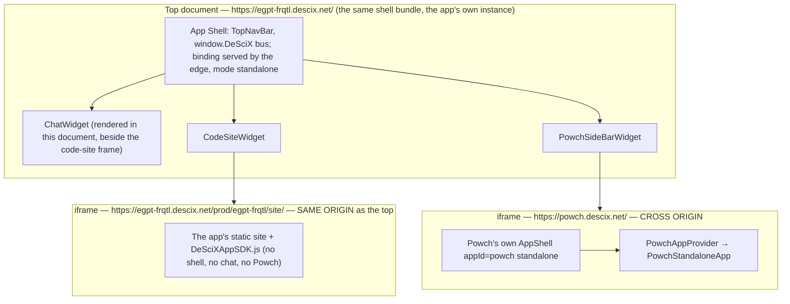
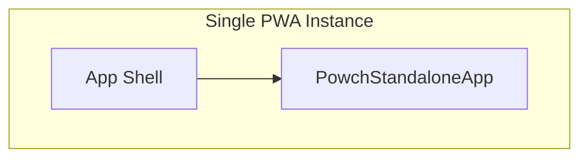

# App Shell Enclosure

This document describes how the Powch App runs inside or alongside the DeSciX App Shell in each deployment case. Powch always has its own isolated App Shell instance.

---

## Core Principle

In every case, the Powch App runs with its own full App Shell (App.jsx, AppContext, AppData, makeCommandRequestJSON, window.DeSciX). It is never a bare UI component; it is always enclosed in the Shell's security domain.

---

## Case 1 — descix.net (Platform)

The frame trees of Cases 1 and 2 are owned by the platform architecture page *Powch, the app shell and app routing: the frame model, as built* (§2); the diagrams below match it. The app shown is `egpt-frqtl`.

- **Top document:** the store shell at `descix.net`. It renders the top bar, the chat widget, the code-site frame and the Powch sidebar, and publishes `window.DeSciX`.
- **Code-site frame:** the app's site, served on the shell's own origin at `descix.net/prod/<appid>/site/`. Shell and app talk by direct JavaScript (the shell's `window.DeSciX`), not by messages.
- **Powch sidebar iframe:** `src` = `__POWCH_APP_URL__` (https://powch.descix.net/ on PROD, https://powch.dev.descix.net/ on DEV; a local build takes the URL `resolvePowchUrl` returns), cross-origin with the shell, at depth 1.
- **Inner shell:** the iframe loads the Powch PWA, which runs its own App Shell (session, makeCommandRequestJSON, window.DeSciX) around PowchStandaloneApp. Powch declares `standalone` in its own code; see Case 3.
- **Communication:** postMessage only, between the shell's PowchBridgeClient / PowchSideBarWidget and Powch, pinned to origins.
- **standalone-vanilla sample:** a host with no DeSciX shell; its PowchClient creates the Powch iframe and talks to it by postMessage. Under a DeSciX shell (Cases 1 and 2) PowchClient delegates to the shell's bridge instead of creating an iframe.

---

## Case 2 — [someapp].descix.net (Standalone App)

- **Top document:** the same shell bundle, served by the edge at the app host's root. It is a second instance of the shell at a second origin, a sibling of `descix.net`, not framed by it. The edge serves its binding (`/__descix/app-binding.json` with mode `standalone` and the app id), so it boots straight into the app.
- **Code-site frame:** the app's site on the app host's own origin at `<appid>.descix.net/prod/<appid>/site/`, same-origin with the shell; the bytes are the ones Case 1 frames.
- **Chat widget:** rendered in the top shell document, as in Case 1.
- **Powch sidebar:** the same Powch document as in Case 1, cross-origin at depth 1, running in its own full Shell instance.

---

## Case 3 — powch.descix.net (Identity Silo)

- Single PWA instance: the Powch PWA is its OWN root app. Powch declares `standalone` in its own code: its site entry mounts `<AppShell appId="powch" standalone>`. A shell that declares `standalone` never probes for a served binding (app-sdk SdkInitializer), and the edge serves none at `powch.<env>.descix.net` (`/__descix/app-binding.json` answers 404)
- The Powch PWA renders PowchStandaloneApp directly as its root; no shell widget is involved
- No Powch sidebar — main content is Powch
- PowchAppProvider, window.DeSciX, session — all in the same window
- Powch is a top-level surface, not a shell-hosted app, so no second iframe

---

## Component References

| Case | Host | Powch Content |
|------|------|---------------|
| 1, 2 | PowchSideBarWidget renders iframe; uses PowchBridgeProvider, usePowchBridge (not Powch's React layer) | iframe src = Powch PWA URL; loads PowchStandaloneApp inside Shell |
| 3 | Powch PWA root (its own App) | Imports PowchStandaloneApp from its own React layer; renders in-process |

**Distinction:** Cases 1 and 2: DeSciX PWA host uses the bridge (PowchBridgeProvider, PowchSideBarWidget, usePowchBridge)—never Powch's React layer. Case 3: the Powch PWA uses its own React layer (PowchAppProvider, PowchStandaloneApp, usePowch) because it is the identity provider.

---

## Related

- [developer-guide.md](../developer-guide.md) — Visibility paradigm, request routing
