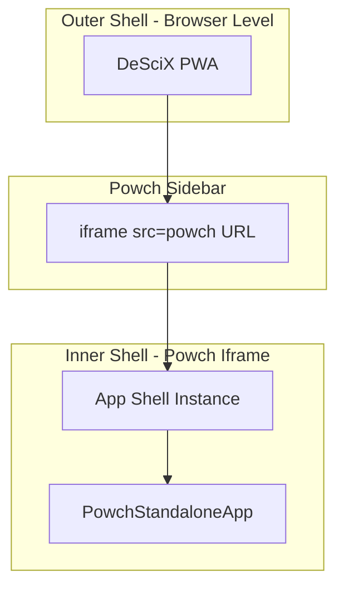
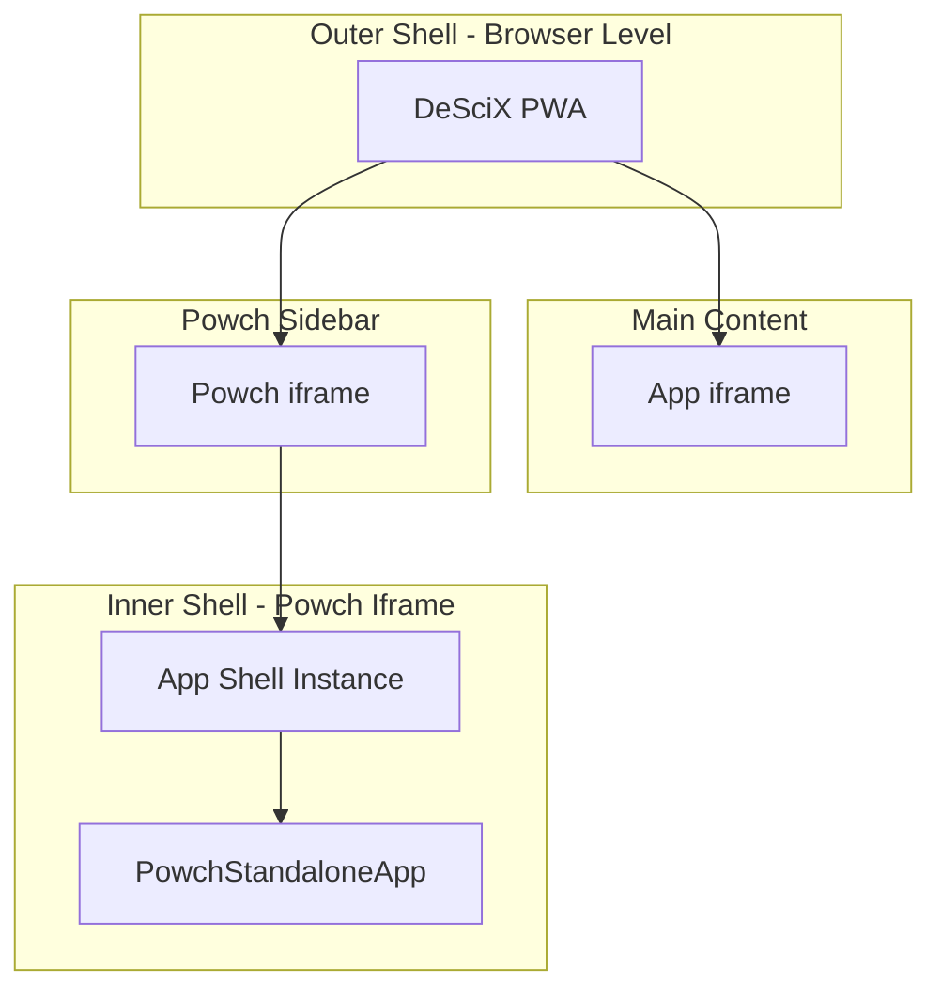
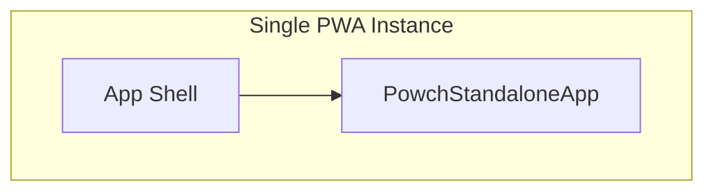

# App Shell Enclosure

This document describes how the Powch App runs inside or alongside the DeSciX App Shell in each deployment case. Powch always has its own isolated App Shell instance.

---

## Core Principle

In every case, the Powch App runs with its own full App Shell (App.jsx, AppContext, AppData, makeCommandRequestJSON, window.DeSciX). It is never a bare UI component; it is always enclosed in the Shell's security domain.

---

## Case 1 — descix.net (Platform)

- **Outer shell:** DeSciX PWA (App.jsx, AppContext, AppData) — the main browser window
- **Powch sidebar iframe:** `src` = `__POWCH_APP_URL__` — the deployed Powch origin, or in local development whatever `env.powchUrl` resolves to. Powch always has its OWN origin; it is never same-origin with the shell.
- **Inner shell:** The iframe loads the Powch PWA — its own root app (PowchStandaloneApp) with its own isolated shell surface; standalone binding is runtime (`descix serve` / edge), never a build-time app id
- **Two app shells:** Host owns the iframe; Powch has its own isolated Shell (session, makeCommandRequestJSON, window.DeSciX) inside the iframe
- **Communication:** postMessage via PowchBridgeClient / PowchSideBarWidget
- **standalone-vanilla sample:** Models this pattern — host creates iframe, uses PowchClient postMessage; correct for all host scenarios

---

## Case 2 — [someapp].descix.net (Standalone App)

- Same as Case 1: host PWA + Powch sidebar iframe
- Main content is the target app iframe; Powch sidebar is shown for auth/pay
- Powch always runs in its own full Shell instance inside its iframe

---

## Case 3 — powch.descix.net (Identity Silo)

- Single PWA instance: the Powch PWA is its OWN root app (standalone binding is runtime — `descix serve` / edge — never a build-time app id)
- The Powch PWA renders PowchStandaloneApp directly as its root; no shell widget is involved
- No Powch sidebar — main content is Powch
- PowchAppProvider, window.DeSciX, session — all in the same window
- Powch is a top-level surface, not a shell-hosted app, so no second iframe

---

## Component References

| Case | Host | Powch Content |
|------|------|---------------|
| 1, 2 | PowchSideBarWidget renders iframe; uses PowchBridgeProvider, usePowchBridge (no @powch/react) | iframe src = Powch PWA URL; loads PowchStandaloneApp inside Shell |
| 3 | Powch PWA root (its own App) | Imports PowchStandaloneApp from @powch/react; renders in-process |

**Distinction:** Cases 1 and 2: DeSciX PWA host uses the bridge (PowchBridgeProvider, PowchSideBarWidget, usePowchBridge)—never `@powch/react`. Case 3: Powch PWA uses `@powch/react` (PowchAppProvider, PowchStandaloneApp, usePowch) because it is the identity provider.

---

## Related

- [standalone-app-shell-and-zero-dependency-design.md](./standalone-app-shell-and-zero-dependency-design.md) — Options going forward (Option A vs B)
- [developer-guide.md](../developer-guide.md) — Visibility paradigm, request routing
