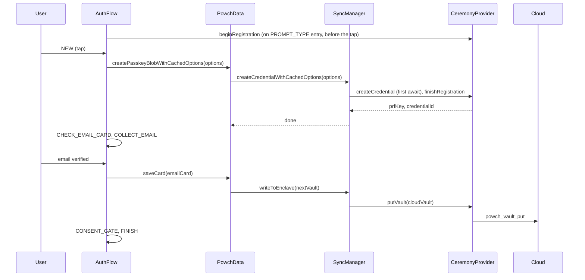

# Cloud Vault Architecture (Design)

This document specifies the **Cloud Vault + Deterministic CloudKey** model. CloudKey is derived from PRF + credentialId; the vault is stored in the cloud. largeBlob is no longer used for Key Object storage.

**References:** [data-security-architecture.md](../data-security-architecture.md), [architecture.md](../architecture.md), [data-layer.md](../data-layer.md), [flow-controllers.md](../flow-controllers.md#authflowcontroller).

**As-built:** No Key Object, no largeBlob. CloudKey is derived from PRF + credentialId; vault is fetched via `powch_vault_get` and put via `powch_vault_put`. Initial vault upload happens implicitly on first `saveCard()` (e.g. EMAIL card after CollectEmailView).

---

## 1. Goals and Constraints

### 1.1 Goals

- **Deterministic CloudKey:** CloudKey is derived from PRF + credentialId via HKDF; no Key Object in largeBlob.
- **Zero-Knowledge:** Server stores only ciphertext; decryption keys remain client- and hardware-bound.
- **Same consumer API:** PowchData remains the single entry point; flows call `unlockWithOptions()`, `createPasskeyBlobWithCachedOptions()`, `saveCards()` / `saveCard()` only, each with options fetched before the tap.
- **Onboarding order:** First-time user: (a) passkey created, (b) CloudKey derived from PRF + credentialId, (c) email verified (DeSciX master ID), (d) vault encrypted and stored in cloud, (e) session token in localStorage.
- **Downstream:** Enable the client-side wallet sheet (the master key printed for cold storage) and server-side deauthorization (revoke vault access).

### 1.2 Architectural Invariants (Unchanged)

- **Flows** never call SyncManager, vaultOps, or cloud APIs directly; they only call PowchData and context getters.
- **SyncManager** is the only component that performs enclave read/create/write and (new) cloud vault fetch/put; it uses an injected CeremonyProvider for WebAuthn and network.
- **PowchAppProvider** registers the CeremonyProvider; no business logic for vault format or keys lives in the provider beyond wiring.
- **vaultOps** remains pure crypto (encrypt/decrypt); no state, no network, no WebAuthn. New helpers for CloudKey and vault-for-cloud encryption live in vaultOps or a dedicated module used only by SyncManager.
- **Tier 1** data (e.g. private keys) stays double-encrypted: inner key PRF-derived (biometric), outer vault encrypted with CloudKey.

---

## 2. Data Model

### 2.1 CloudKey (Derived, Not Stored)

CloudKey is **deterministically derived** from PRF output and credentialId:

```
CloudKey = HKDF-SHA256(prfOutput, credentialId, "DeSciX-CloudKey-v1")
```

- **No largeBlob Key Object.** CloudKey is re-derived on each biometric ceremony (read, write, export).
- **Stateless recovery:** User can recover on any device with passkey + keychain sync (iCloud, Google).

### 2.2 Cloud Vault (Stored in DeSciX Cloud)

- **Content:** Same BlobV3 structure as today (see data-security-architecture): `{ version: 3, cards: { ... } }`.
- **Encryption:** AES-256-GCM with **CloudKey** (not PRF). Tier 1 fields inside the vault remain **double-encrypted** (inner: PRF-derived key; outer: part of this blob).
- **Location:** Backed by backend storage (e.g. Firestore document or blob store) keyed by user/vaultId; access controlled by DeSciX auth (JWT from WebAuthn finishLogin).

### 2.3 Tier 1 Double Encryption (Unchanged Semantically)

- **Outer:** Whole vault (including Tier 1 ciphertexts) is encrypted with CloudKey for cloud storage.
- **Inner:** Private keys and other Tier 1 fields are encrypted with a key derived from PRF (e.g. existing `encryptPrivateKey` / `decryptPrivateKey` in vaultOps). Decrypting or writing Tier 1 still requires a biometric ceremony to obtain PRF output (or cached PRF for the session).

### 2.4 Session Token

- Issued by backend on `powch_login_finish` (unchanged). Stored in localStorage (or existing session mechanism) for authenticated API calls (e.g. vault fetch/put).

### 2.5 Secure Data Boundary (CRITICAL)

**Sensitive data** (passkeyBlob, prfOutput, cloudKey, decrypted vault, raw key material) MUST NOT cross the Powch iframe boundary. Never include in resolveAction payloads, postMessage to parent, or any host-facing API.

- **powch_login_finish response:** Returns only `{ token, credentialId }`; client obtains passkeyBlob/prfOutput from `assertion.clientExtensionResults`.
- **resolveAction / postMessage:** Filter to host-safe allowlist: token, credentialId, email, walletAddress, sessionInfo, auth_status, success.
- **Phase 2:** `PowchData.factories.toHostSafe(raw)` enforces this centrally.

---

## 3. Ceremonies and Flows

### 3.1 Registration (First-Time / Onboarding)

Target order: **Passkey create → CloudKey derived → Email verified → Upload initial vault → Session.**

- **a) Passkey create:** Call WebAuthn create. Attestation returns PRF output and credentialId.
- **b) CloudKey derived:** `deriveCloudKeyFromPRF(prfOutput, credentialId)` yields 32-byte CloudKey. Never sent to the server.
- **c) Initial vault:** Create empty BlobV3, encrypt with CloudKey, upload via `powch_vault_put`. Deferred until email verified.
- **d) Session:** `finishLogin` returns session token; store in localStorage.


**As-built:** No `createPasskeyAndBootstrapCloud`. Flow calls `createPasskeyBlobWithCachedOptions()` on the New-account tap; initial vault upload happens on first `saveCard()`.
### 3.2 Login (Startup)

- **Unlock ceremony:** the flow fetches the sign-in options when a sign-in screen is entered (`PowchData.beginLoginOptions()`) and calls `PowchData.unlockWithOptions(options)` on the tap.
- **SyncManager.readWithOptions(options)** behavior (the ceremony is its first await):
  1. WebAuthn get with PRF only (no largeBlob read).
  2. Derive CloudKey from `prfOutput` and `credentialId`.
  3. Fetch cloud vault via `powch_vault_get`, decrypt with CloudKey.
  4. Finish login with server (session token). Return `{ blob, prfKey, credentialId }`. PowchData.unlockWithOptions() hydrates `_vault` and Tier3 from blob.

Flows and views do not change; only the implementation behind `SyncManager.readWithOptions()` and the backend do.

### 3.3 Save (Write Path)

- **saveCard:** Flow calls `PowchData.saveCards(cards, options)` from the vault-save tap step (vaultSaveStep.js).
- **SyncManager.writeToEnclave(vault, credentialId)** behavior:
  1. WebAuthn get with PRF only. Derive CloudKey from prfOutput and credentialId.
  2. Encrypt vault with CloudKey for cloud.
  3. Upload encrypted vault to backend (`powch_vault_put`).

Tier 1 fields are still encrypted with PRF-derived key inside the vault before the whole vault is encrypted with CloudKey; that logic stays in vaultOps/card layer.

---

## 4. Downstream Capabilities

### 4.1 The wallet sheet (Cold Storage)

- **Intent:** the user keeps the 24 words (`cloudKeyToMnemonic`, Powch's encoding: not a standard wallet seed) and the master private key as hex, which any EVM wallet imports to reach the master address's funds (funds-only recovery: the account, vault and credits stay with the lost passkey).
- **Implementation:** client-core `recoverySheetFromCloudKey(cloudKey)`. Right after create, `PowchData.heldWalletSheet()` reads the CloudKey this document holds (no tap); later, `PowchData.printWalletSheet(options)` runs a biometric ceremony (its first await, on the tap) via `getPrfForExport(options)`.
- **Placement:** AuthFlow `PRINT_WALLET` after the passkey is created and before the email step (mandatory), and at sign-in when the account has no `recovery_confirmed_at`; "Print my wallet" (`PrintWalletFlowController`) in Portfolio, the menu and Wallet Manager. A print stylesheet prints the sheet alone; no Copy button. Never rendered in a frame under a host page: from the Powch panel on a site, the demand and "Print my wallet" run in the top-level Powch window (`PRINT_WALLET_AT_TOP_LEVEL`, `PowchData.unlockForWalletSheet` there).

### 4.2 Deauthorization (Stolen Device)

- **Intent:** Revoke access to the cloud vault so that a stolen device cannot fetch the latest vault without server cooperation.
- **Mechanism:** Backend stores a “vault access” policy or revocation list (e.g. per user or per credentialId). New command, e.g. `powch_vault_revoke`, or a flag on the user record. When `powch_vault_get` is called, backend checks revocation and returns 403 or empty if revoked.
- **Client:** Optional “Revoke this device” in settings that calls a backend revoke endpoint; no change to SyncManager semantics except that a subsequent vault fetch may fail (handled as today for network errors).

---

## 5. File-by-File Update Plan

### 5.1 Client-Core (Packages/client-core)

| File | Change | Encapsulation |
|------|--------|----------------|
| **vaultOps.js** | `generateCloudKey()`, `encryptVaultForCloud(vaultBlob, cloudKey)`, `decryptVaultFromCloud(encryptedBlob, cloudKey)`, `serializeKeyObject(keyObject)`, `parseKeyObject(bytes)` for Key Object. Tier 1 helpers (`encryptPrivateKey`, `decryptPrivateKey`) unchanged. Legacy `encryptBlobForStorage`/`decryptBlobFromStorage` removed. | Pure crypto and serialization only; no network, no WebAuthn. |
| **PowchData.js** | **SyncManager:** Implement Key Object + cloud path: In `readWithOptions()`, after largeBlob read, detect format (Key Object vs legacy). If Key Object: call CeremonyProvider to fetch vault (e.g. `fetchVault()`), decrypt with CloudKey, return blob. If legacy: decrypt with PRF as today. In `writeToEnclave()`, encrypt vault with CloudKey (from in-memory or from a read), call CeremonyProvider to put vault (e.g. `putVault(encrypted)`), optionally write Key Object to largeBlob if needed. Add **SyncManager** method `bootstrapCloudVault()` or equivalent: generate CloudKey, build Key Object, write to largeBlob, create empty vault, encrypt for cloud, call provider.putVault. **PowchData** may expose `createPasskeyAndBootstrapCloud()` that calls createCredential() then sync.bootstrapCloudVault() so the flow has a single “new user” entry point; internal state (e.g. CloudKey) stays inside SyncManager or a closure used only for that session until written to largeBlob. | SyncManager remains the only place that knows about Key Object and cloud vault; PowchData public API stays unlock/createPasskeyBlob/saveCard (+ optional bootstrap method). Flows still never touch SyncManager. |

### 5.2 CeremonyProvider and Network (React / PowchAppProvider)

| File | Change | Encapsulation |
|------|--------|----------------|
| **PowchAppProvider.jsx** | Extend CeremonyProvider: add `fetchVault()` and `putVault(cloudVault)`. Call makeRequest('powch_vault_get', {}) and makeRequest('powch_vault_put', { cloudVault }). No business logic; only wiring. | Provider stays a thin adapter; no key or format logic. |
| **core/PowchNetworkAPI.js** | No change required if makeRequest is generic. Optional: add `getVault()` / `putVault(body)` that call the new commands. | Optional convenience only. |

### 5.3 Backend (Service)

| File | Change | Encapsulation |
|------|--------|----------------|
| **microservice/src/index.js** (or equivalent API entry) | Add commands: `powch_vault_get`: require auth (JWT/session), return stored encrypted vault blob for the authenticated user. `powch_vault_put`: require auth, accept encrypted vault blob, store by user (overwrite). Optional: `powch_vault_revoke` for deauthorization. | Backend never sees CloudKey or plaintext; only stores/returns opaque ciphertext. |
| **Storage** (e.g. Firestore) | Define schema for “vault blob per user” (or per vaultId). Store encrypted payload only. | No key material. |

### 5.4 Flows and Views

| File | Change | Encapsulation |
|------|--------|----------------|
| **flows/AuthFlowController.js** | **Onboarding order (new user, T-FLOW-PASSKEY-FIRST 2026-04-22):** PROMPT_TYPE(NEW) → AIRDROP_ONBOARDING_CHOICE → CREATE_PASSKEY_BLOB → COLLECT_EMAIL_TOS_PK (gate PASS) → CONSENT_GATE → FINISH. The legacy pre-passkey VERIFY_AIRDROP_WALLET + standalone COLLECT_EMAIL states were removed; the token gate runs server-side inside descix_accept_tos. Flow only calls PowchData; no SyncManager or vaultOps. | Business logic stays in flow state machine; views remain presentational. |
| **views/CollectEmailView.jsx** | No change to encapsulation. If verification step is required before passkey create, the flow drives when to show CollectEmailView (e.g. before CREATE_PASSKEY_BLOB for new users). | View only emits SUCCESS/FAIL with payload; flow decides next state. |
| **views/UnlockFailedView.jsx** | Shows the browser's own error (describeWebAuthnError); Try again is disabled until fresh sign-in options load. | — |
| **flows/FlowRunner.js** | Pre-flight sign-in tap step (UnlockFlowController); no awareness of cloud vs local. | — |
| **flows/BaseFlowController.js** | No change. | — |
| **flows/WalletConnectFlowController.js**, **SignFlowController.js** | No change. They rely on vault being unlocked; how it was filled is opaque. | — |

### 5.5 PowchData Public API Summary (After Changes)

- **initialize()** — unchanged.
- **unlockWithOptions(options)** — uses SyncManager.readWithOptions(options), which may do cloud fetch + CloudKey decrypt.
- **createPasskeyBlobWithCachedOptions(options, data)** — As-built entry point for new user registration (options prefetched on screen entry). Called by AuthFlowController in CREATE_PASSKEY_BLOB state.
- **createPasskeyAndBootstrapCloud()** — planned Phase 2. Would combine credential creation with initial vault upload. Implementation delegates to SyncManager.
- **saveCards(cards, options)** — uses SyncManager.writeToEnclave(vault, credentialId, options), which encrypts with CloudKey and puts to cloud.
- **lock()**, **reset()** — unchanged. Clear in-memory CloudKey if ever stored in PowchData (prefer not to; keep CloudKey only in SyncManager or inside read/write paths).

### 5.6 Key Object Only (No Legacy)

- **SyncManager.readWithOptions():** If passkeyBlob parses as Key Object, use cloud path (fetchVault, decrypt with CloudKey). Otherwise treat as null/empty vault (new user). No legacy full-blob support.
- **SyncManager.writeToEnclave():** Requires Key Object; throws if missing. Use createPasskeyAndBootstrapCloud for new users.

---

## 6. Sequence Overview

### 6.1 New User (Onboarding)



### 6.2 Returning User (Login)

```mermaid
sequenceDiagram
  participant User
  participant Flow
  participant PowchData
  participant SyncManager
  participant CeremonyProvider
  participant Cloud

  Flow->>CeremonyProvider: beginLogin (on sign-in screen entry, before the tap)
  User->>Flow: Returning (tap)
  Flow->>PowchData: unlockWithOptions(options)
  PowchData->>SyncManager: readWithOptions(options)
  SyncManager->>CeremonyProvider: authenticate(PRF only, first await), finishLogin
  SyncManager->>SyncManager: derive CloudKey from PRF + credentialId
  SyncManager->>CeremonyProvider: fetchVault()
  CeremonyProvider->>Cloud: powch_vault_get
  Cloud-->>CeremonyProvider: encrypted vault
  SyncManager->>SyncManager: decryptVaultFromCloud(encrypted, cloudKey)
  SyncManager-->>PowchData: blob, prfKey, credentialId
  PowchData->>PowchData: hydrate _vault, Tier3; VAULT_UNLOCKED
```

---

## 7. Summary

- **Vault** is stored in the cloud as an encrypted blob. No largeBlob; CloudKey derived from PRF + credentialId on each ceremony.
- **Onboarding:** createPasskeyBlobWithCachedOptions → COLLECT_EMAIL → saveCard(emailCard) triggers first vault upload.
- **Read/Write** semantics of PowchData (unlock, saveCard) are unchanged for consumers.
- **Downstream:** the wallet sheet via recoverySheetFromCloudKey; deauthorization via backend revoke and vault_get enforcement.
