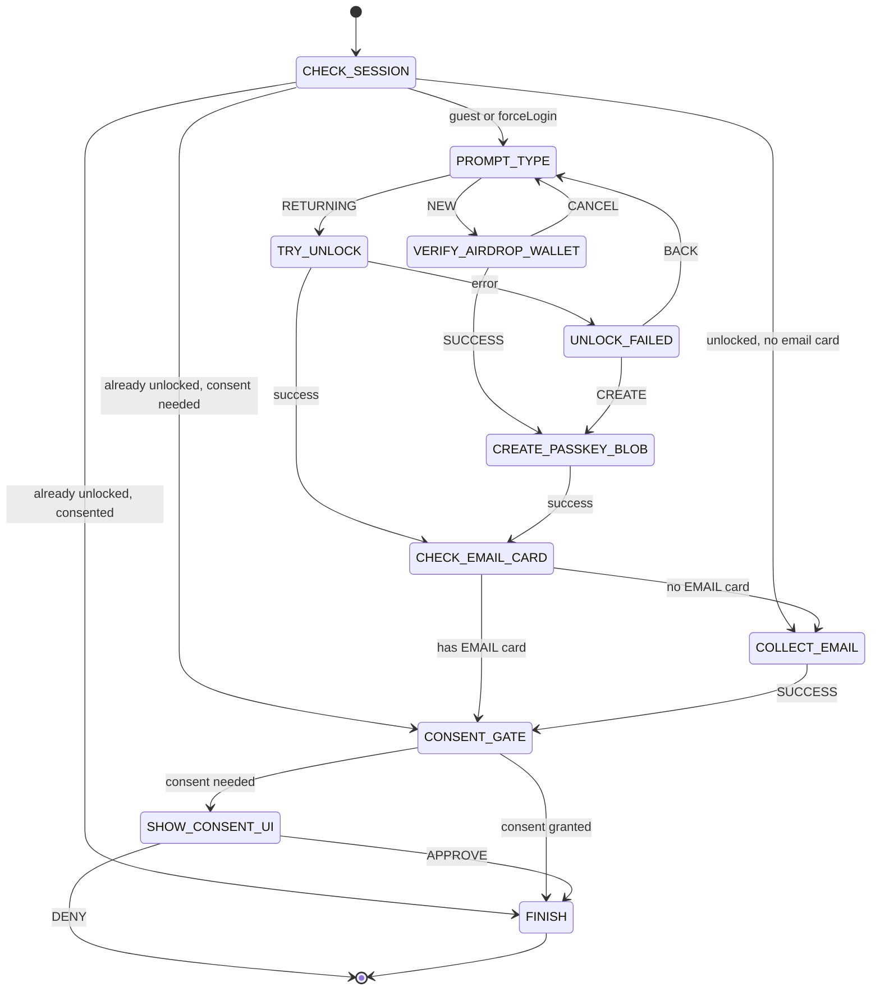

# Design: AUTH Flow (Get ID Card for Site)

> **⚠️ STALE — superseded by T-FLOW-PASSKEY-FIRST restructure (2026-04-22).**
>
> The state machine described below reflects the pre-restructure flow with
> `VERIFY_AIRDROP_WALLET` / `TokenGateView` and a standalone `COLLECT_EMAIL`
> state. Those states no longer exist. The current flow routes through
> `AIRDROP_ONBOARDING_CHOICE` + consolidated `COLLECT_EMAIL_TOS_PK` with the
> token gate moved server-side into `descix_accept_tos`. See
> `docs/flow-controllers.md` and `docs/airdrop-onboarding-flow.md` for the
> current state machine.
>
> This file preserves the pre-restructure design for historical / audit
> reference only.

---

## 1. Overview

The AUTH flow handles user identification, authentication (biometric), and data sharing consent. Purpose: "Get an identity card for this site." It can be triggered by a host site (SSO) or by the App Shell (Login). Implemented by **AuthFlowController**; started on `POWCH_LOGIN` or `POWCH_AUTH` with options `origin`, `require`, `purpose`, `brand`, and **`forceLogin`**. **requirements.vaultUnlocked:** false (this flow handles unlock/create itself via PowchData.unlock() and PowchData.createPasskeyBlob()).

## 2. State Machine (As-Built)

States and transitions match `packages/react/src/flows/AuthFlowController.js`.

| State | Type | View / Action |
| :--- | :--- | :--- |
| `CHECK_SESSION` | action | If vault already unlocked and !forceLogin: check email card and consent → FINISH, CONSENT_GATE, or COLLECT_EMAIL. If hasCredential → TRY_UNLOCK. Else → PROMPT_TYPE. |
| `PROMPT_TYPE` | UI | PowchMainView |
| `VERIFY_AIRDROP_WALLET` | UI | TokenGateView — user proves they hold DAITA tokens via airdrop wallet PK. All crypto (key derivation, signing) happens client-side. Server receives only (address, signature). PK is cached in ctrl.data until vault is created, then saved as encrypted card. On SUCCESS (with importedPrivateKey, importedWalletAddress) → CREATE_PASSKEY_BLOB. On CANCEL → PROMPT_TYPE. |
| `TRY_UNLOCK` | action | **PowchData.unlock()**; on success → CHECK_EMAIL_CARD; on error → UNLOCK_FAILED |
| `UNLOCK_FAILED` | UI | UnlockFailedView ("No account found" / cancelled; Create New Account or Back) |
| `CREATE_PASSKEY_BLOB` | action | **PowchData.createPasskeyBlob()**; on success → CHECK_EMAIL_CARD |
| `CHECK_EMAIL_CARD` | action | If EMAIL card exists → CONSENT_GATE; else → COLLECT_EMAIL |
| `COLLECT_EMAIL` | UI | CollectEmailView; on SUCCESS flow creates EMAIL card and calls **PowchData.saveCard(emailCard)** → CONSENT_GATE |
| `CONSENT_GATE` | action | If no PII requested or `hasConsent(origin, require)` → FINISH. Else → SHOW_CONSENT_UI. *CONSENT_GATE silently passes only when `hasConsent(origin, require)` is true (vault-stored consent from prior "Remember this choice").* |
| `SHOW_CONSENT_UI` | UI | ConsentView (props: requestedFields, siteName, purpose, walletData) |
| `FINISH` | action | Result filtered by consented fields; completeRequestInternal(result); resolve(result) |

## 3. Events & Transitions

| Event | Source | Next State / Effect |
| :--- | :--- | :--- |
| (flow start) | Host / App | `CHECK_SESSION` (options: origin, require, purpose, brand, forceLogin) |
| `RETURNING` | PowchMainView | `TRY_UNLOCK` |
| `NEW` | PowchMainView | `VERIFY_AIRDROP_WALLET` |
| `SUCCESS` | TokenGateView | `CREATE_PASSKEY_BLOB` (with importedPrivateKey, importedWalletAddress cached in ctrl.data) |
| `CANCEL` | TokenGateView | `PROMPT_TYPE` |
| `CREATE` | UnlockFailedView | `CREATE_PASSKEY_BLOB` |
| `BACK` | UnlockFailedView | `PROMPT_TYPE` |
| `SUCCESS` | CollectEmailView | Flow creates EMAIL card, **PowchData.saveCard(emailCard)** → `CONSENT_GATE` |
| `APPROVE` | ConsentView | Persist consent via setSiteSettings **only when rememberChoice**; → `FINISH` (result filtered by consented fields) |
| `DENY` | ConsentView | reject('User denied consent') |

## 4. Background Actions (Non-Visual)

*   **Unlock vault**: In `TRY_UNLOCK`, the flow calls **PowchData.unlock()** (parameterless). PowchData delegates to SyncManager.read() (WebAuthn get + PRF; fetch vault from cloud, decrypt with CloudKey); vault and Tier3 are hydrated (or empty if cloud vault is null). Email is available via `PowchData.getCards(CARD_TYPES.EMAIL)` after unlock.
*   **Token gate (new user)**: In `VERIFY_AIRDROP_WALLET`, the user proves they hold DAITA tokens via an airdrop wallet private key. All crypto happens client-side in TokenGateView; the server receives only (address, signature). On success, the imported PK and wallet address are cached in ctrl.data for later card creation.
*   **Create passkey blob (new user)**: In `CREATE_PASSKEY_BLOB`, the flow calls **PowchData.createPasskeyBlob()**, which uses SyncManager.createCredential() (WebAuthn create). No email or vault write at this step.
*   **Persist email**: When CollectEmailView returns SUCCESS, AuthFlowController creates an EMAIL card and calls **PowchData.saveCard(emailCard)** (SyncManager.writeToEnclave).
*   **Consent**: `completeRequestInternal` and `setSiteSettings` update site consent (Tier 3).
