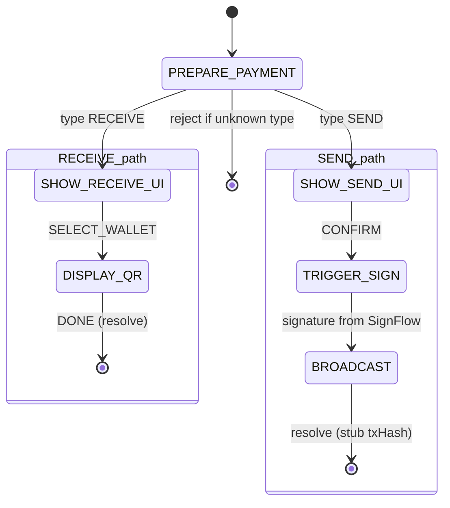

# Design: PAYMENT Flow (Receive & Send)

## 1. Overview
The PAYMENT flow handles the high-level intents of receiving funds (Invoicing) and sending funds (Payments). Implemented by **PaymentFlowController**; the protocol machine starts it on `POWCH_RECEIVE` (options enriched with `type: 'RECEIVE'`) or `POWCH_SEND` (options enriched with `type: 'SEND'`). Nested signing uses the ref-based **`context.dispatchFlow(SignFlowController, ...)`** so the controller can start the Sign flow without calling React hooks.

**As-built note**: BROADCAST and QR generation are stubs/placeholders; the flow resolves with placeholder data where real broadcast or QR would be implemented.

## 2. State Machine (As-Built)

Single script in `packages/react/src/flows/PaymentFlowController.js`; branch by `options.type` in PREPARE_PAYMENT.

| State | Type | View / Action |
| :--- | :--- | :--- |
| `PREPARE_PAYMENT` | action | Branch by options.type: RECEIVE → SHOW_RECEIVE_UI, SEND → SHOW_SEND_UI |
| `SHOW_RECEIVE_UI` | UI | WalletManagerView (mode: receive) |
| `DISPLAY_QR` | UI | HomeView (placeholder for QR) |
| `SHOW_SEND_UI` | UI | WalletConnectView (send form). On CONFIRM, the view must supply tx and fromAddress (e.g. in event data) so ctrl.data.tx and ctrl.data.fromAddress are set before TRIGGER_SIGN. |
| `TRIGGER_SIGN` | action | `context.dispatchFlow(SignFlowController, { type: 'POWCH_SIGN_TX', tx: ctrl.data.tx, address: ctrl.data.fromAddress })`; then → BROADCAST with signature. Requires ctrl.data.tx and ctrl.data.fromAddress. |
| `BROADCAST` | action | Resolve with placeholder (e.g. txHash: '0x...'); real broadcast not yet implemented |

## 3. Events & Transitions

| Event | Source | Next State / Effect |
| :--- | :--- | :--- |
| (flow start) | Machine | `PREPARE_PAYMENT` (options: type RECEIVE/SEND, amount, token, reason, destination) |
| `SELECT_WALLET` | WalletManagerView (receive) | `DISPLAY_QR` (with address) |
| `DONE` | HomeView (QR placeholder) | resolve({ success: true }) |
| `CONFIRM` | WalletConnectView (send) | `TRIGGER_SIGN` (WalletConnectView should set ctrl.data.tx and ctrl.data.fromAddress when confirming, so TRIGGER_SIGN has the transaction and signer address) |
| (internal) | TRIGGER_SIGN | `BROADCAST` with signature from nested SignFlow |

## 4. Background Actions (Non-Visual)
*   **Nested sign**: `TRIGGER_SIGN` calls `context.dispatchFlow(SignFlowController, { type: 'POWCH_SIGN_TX', tx: ctrl.data.tx, address: ctrl.data.fromAddress })` and awaits the returned signature. This uses the ref-based dispatcher so the flow controller does not call the React `startFlow` hook directly.
*   **BROADCAST**: In as-built, resolves with a placeholder; real broadcast (and gas estimation) to be added later.
*   **QR generation**: Not yet implemented; DISPLAY_QR currently uses HomeView as placeholder.
