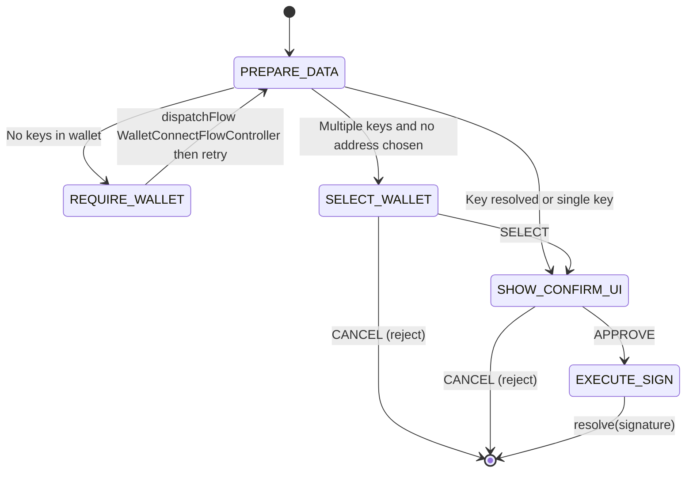

# Design: SIGN Flow (Transactions & Messages)

## 1. Overview

The SIGN flow handles the secure signing of Ethereum transactions, personal messages, or typed data. Implemented by **SignFlowController**; started on `POWCH_SIGN`, `POWCH_SIGN_TX`, `POWCH_SIGN_MESSAGE`, or `POWCH_SIGN_TYPED_DATA` with options including `type`, `tx` / `message` / `domain`+`types`+`value`, and `address`. **requirements.vaultUnlocked:** true — FlowRunner calls **PowchData.unlock()** before starting this flow if the vault is locked (and credential exists). There is no AUTH_REQUIRED state; PREPARE_DATA assumes the vault is already unlocked.

The controller uses **PowchData.resolveAddress(address)** to get cardId and keyIndex, and **PowchData.signTransaction** / **signMessage** / **signTypedData** (with makeApiRequest from context) for signing.

## 2. State Machine (As-Built)

States and transitions match `packages/react/src/flows/SignFlowController.js`.

| State | Type | View / Action |
| :--- | :--- | :--- |
| `PREPARE_DATA` | action | Vault is already unlocked (FlowRunner pre-flight). **PowchData.resolveAddress(address)** → cardId, keyIndex; require wallet when no cards; multiple keys and no address → SELECT_WALLET; else → SHOW_CONFIRM_UI |
| `REQUIRE_WALLET` | action | `context.dispatchFlow(WalletConnectFlowController, { purpose, isRequirement: true })`; on success set ctrl.data.address → PREPARE_DATA; else reject |
| `SELECT_WALLET` | UI | PowchTransactionFlow (mode: 'select'); SELECT(address, keyIndex) → SHOW_CONFIRM_UI; CANCEL → reject |
| `SHOW_CONFIRM_UI` | UI | PowchTransactionFlow (address, keyIndex, action, txData, amount, recipient, gasEstimate); APPROVE → EXECUTE_SIGN; CANCEL → reject |
| `EXECUTE_SIGN` | action | **PowchData.signTransaction(cardId, txData, makeRequest)** / **signMessage** / **signTypedData**; resolve(result) |

## 3. Events & Transitions

| Event | Source | Next State / Effect |
| :--- | :--- | :--- |
| (flow start) | Machine | `PREPARE_DATA` (vault already unlocked by FlowRunner) |
| (internal) | PREPARE_DATA | `REQUIRE_WALLET` \| `SELECT_WALLET` \| `SHOW_CONFIRM_UI` |
| (internal) | REQUIRE_WALLET | `PREPARE_DATA` after successful WalletConnectFlowController (ctrl.data.address set) |
| `SELECT` | PowchTransactionFlow (select mode) | `SHOW_CONFIRM_UI` (address, keyIndex in data) |
| `APPROVE` | PowchTransactionFlow (confirm) | `EXECUTE_SIGN` |
| `CANCEL` | PowchTransactionFlow | reject |

## 4. Background Actions (Non-Visual)

*   **Resolve key**: **PowchData.resolveAddress(address)** yields `{ walletId: cardId, keyIndex }` (or null). When no cards exist, flow requires wallet (REQUIRE_WALLET). Signing uses the cached `_prfKey` when vault is unlocked.
*   **Signing**: **PowchData.signTransaction(cardId, txData, makeRequest)**, **signMessage**, **signTypedData** perform signing via PowchData.
