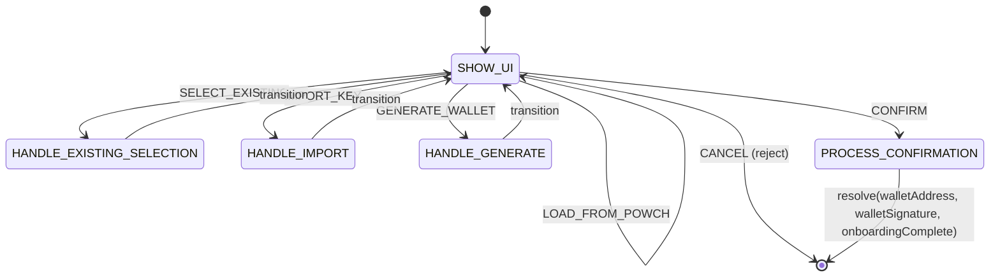

# Design: WALLET CONNECT Flow

## 1. Overview

The WALLET CONNECT flow handles wallet selection, import, generation, and optional message signing for host-originated "connect wallet" requests. It can be triggered by the Host via **POWCH_CONNECT_WALLET** or as a **sub-flow** from SignFlowController when the user has no keys (REQUIRE_WALLET). Implemented by **WalletConnectFlowController**.

**requirements.vaultUnlocked:** true. When the vault is locked (and a credential exists), **FlowRunner** shows the sign-in tap step (UnlockPromptView) before starting this flow. There is no **ACQUIRE_PRF** state; **LOAD_FROM_POWCH** transitions directly to **SHOW_UI** (vault is already unlocked by pre-flight).

## 2. State Machine (As-Built)

States and transitions match `WalletConnectFlowController` in Powch's React layer.

| State | Type | View / Action |
| :--- | :--- | :--- |
| `SHOW_UI` | UI | WalletConnectView (props: signatureMessage, startMode, instruction, isRequirement from options) |
| `HANDLE_EXISTING_SELECTION` | action | Set selectedAddress, mode 'existing'; → SHOW_UI |
| `HANDLE_IMPORT` | action | Derive address from privateKey; set pendingCard, selectedAddress, mode 'import'; → SHOW_UI |
| `HANDLE_GENERATE` | action | ethers.Wallet.createRandom(); set pendingCard, selectedAddress, mode 'create'; → SHOW_UI |
| `PROCESS_CONFIRMATION` | action | If signatureMessage: sign (local or signWithSession); if pendingCard: → VAULT_SAVE_PROMPT (the vault-save tap step saves it, then resolves); else resolve(result) |

## 3. Events & Transitions

| Event | Source | Next State / Effect |
| :--- | :--- | :--- |
| (flow start) | Host / sub-flow | `SHOW_UI` (vault already unlocked by FlowRunner) |
| `SELECT_EXISTING` | WalletConnectView | `HANDLE_EXISTING_SELECTION` (ctrl.data.address from selection) |
| `IMPORT_KEY` | WalletConnectView | `HANDLE_IMPORT` (privateKey, label in data) |
| `GENERATE_WALLET` | WalletConnectView | `HANDLE_GENERATE` (label in data) |
| `LOAD_FROM_POWCH` | WalletConnectView | `SHOW_UI` (no separate unlock step; vault unlocked by Runner) |
| `CONFIRM` | WalletConnectView | `PROCESS_CONFIRMATION` |
| `CANCEL` | WalletConnectView | reject('Wallet connect cancelled') |

## 4. Background Actions (Non-Visual)

*   **Sign**: In PROCESS_CONFIRMATION, if `signatureMessage` is set and no pendingCard (in-memory key), `context.signWithSession(signatureMessage, selectedAddress)`. If pendingCard has secret, sign locally with ethers.Wallet.
*   **Save card**: If `pendingCard` is set (new CRYPTO_WALLET), it is saved from the vault-save tap step (VaultSavePromptView; **PowchData.saveCards**, SyncManager.writeToEnclave), whose button waits for the vault-write options.
*   **Resolve payload**: Flow resolves with `{ walletAddress, walletSignature?, onboardingComplete: true }` for the Host or calling flow.
