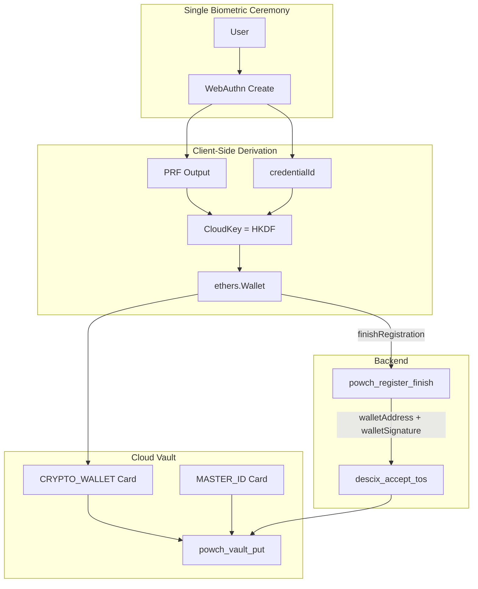

# PRF-Derived Master Wallet: Full Walkthrough

This document describes how Powch derives the master crypto wallet from the passkey's PRF output, enabling **one-touch registration** that connects users to the crypto world—no seed phrases, no separate wallet setup.

**Related**: [authentication.md](../authentication.md), [architecture.md](../architecture.md), [data-security-architecture.md](../data-security-architecture.md).

---

## 1. Overview and Rationale

### One Touch to Crypto

A single biometric ceremony (WebAuthn create) creates both:

1. **Identity**: The passkey and credentialId
2. **Master wallet**: Derived deterministically from the PRF output

The master wallet private key **is** the CloudKey (32-byte value). No second ceremony is needed. Users reach CONNECTED (identity + crypto wallet on record) after email verification and TOS acceptance.

### Design Benefits

- **Stateless recovery**: CloudKey can be re-derived on any device with the passkey and keychain sync (iCloud, Google). No largeBlob storage for the key.
- **Single ceremony**: One biometric for passkey + wallet; wallet params sent atomically with registration.
- **Zero-knowledge**: Backend never sees PRF output, CloudKey, or private keys. It receives only attestation, walletAddress, and walletSignature.

---

## 2. Cryptographic Flow

### PRF Salt

The WebAuthn PRF extension uses a **system-wide salt** (`powch-prf-v1`) across all Powch operations for consistency and cross-device sync.

### CloudKey Derivation

```
CloudKey = HKDF-SHA256(prfOutput, credentialId, "DeSciX-CloudKey-v1")
```

- **prfOutput**: 32-byte result from `assertion.clientExtensionResults?.prf?.results?.first`
- **credentialId**: WebAuthn credential ID from the attestation
- **Info string**: `"DeSciX-CloudKey-v1"` (domain separation)

**Implementation**: client-core `vaultOps` — `deriveCloudKeyFromPRF`.

### Master Wallet = CloudKey as Private Key

The CloudKey (32 bytes) is used directly as the Ethereum private key:

```javascript
wallet = new ethers.Wallet(ethers.hexlify(cloudKey));
```

No additional derivation. The wallet address is `wallet.address`; signing uses `wallet.signMessage()` or `wallet.signTransaction()`.

---

## 3. Registration Sequence

### SyncManager.createCredential

**Location**: client-core `PowchData` — SyncManager class.

1. WebAuthn create ceremony (attestation + PRF)
2. Read the PRF output (client-core `registrationPrf` — `classifyRegistrationPrf`); see "Passkey providers without PRF" for the four shapes. A refusal throws `PasskeyProviderRefusedError` (carrying the passkey's AAGUID) before `finishRegistration`: nothing is registered
3. Derive CloudKey from PRF + credentialId
4. Create wallet: `new ethers.Wallet(ethers.hexlify(cloudKey))`
5. If `signatureMessage` provided: sign with wallet
6. Call `finishRegistration({ attestation, walletAddress, walletSignature })`

The CeremonyProvider's `finishRegistration` invokes `powch_register_finish` on the backend. The backend receives wallet params **atomically** with the attestation; no second ceremony.

### Backend: NOT_AUTHENTICATED

`powch_register_finish`:

- Refuses a passkey that reported no PRF (server-core `assertRegistrationHasPrf`: neither `prf.enabled === true` nor a PRF output) with `PrfRequiredError`, before verifying the attestation: no User document, no session
- Verifies attestation (zero-knowledge)
- Get-or-creates User by credentialId
- Stores wallet_address and signature on the user document
- Creates session → `sessionInfo` with status `NOT_AUTHENTICATED`

### createPasskeyBlobWithCachedOptions (DeSciX Flow)

`PowchData.createPasskeyBlobWithCachedOptions(options, { getSignatureMessage, deferWalletRegistration })`:

- Calls `SyncManager.createCredentialWithCachedOptions(options, registrationData)` with options prefetched before the tap
- Stores `_cloudKey`, `_prfKey`, empty vault
- No cloud vault write until email verified (see Vault Persistence below)

### Passkey providers without PRF

The decision is the PRESENCE of `prf.results.first` (32 bytes, `registrationPrf.prfFirst`), never the browser or device, and never `prf.enabled` alone: a successful get() reports `enabled: null` with a 32-byte `first` (Apple Passwords), so `enabled` is read only at create(), only when `first` is absent.

| create() PRF result (shape) | Outcome |
|---|---|
| `results.first` present (output-returned) | registration proceeds |
| `enabled: true`, no `results.first` (enabled-no-output) | not a refusal: a `get()` with the same PRF eval against the new credential only (local challenge; nothing is registered yet) supplies the output. If the browser needs a new tap for it, ConfirmPasskeyPrfView ("Confirm your passkey once more to finish") runs that `get()` as the tap's first await. A `get()` with no output either: refused, reason `prf-no-output` |
| `enabled: false` (not-enabled) | refused: reason `prf-not-supported` |
| no `prf` result (prf-absent) | refused: reason `prf-not-supported` |

Chrome's older local authenticator ("Chrome on Mac", AAGUID `adce0002-35bc-c60a-648b-0b25f1f05503`) reports `enabled: false` at create() and returns no output at get(): it is refused, and a further get() would not help.

A refused passkey stays in the provider that saved it, unregistered and holding no wallet. The provider is read from the AAGUID in the attestationObject's authenticator data (only create() carries it) and named from Powch's AAGUID table. PasskeyProviderRefusedView (titled with the provider name, e.g. "Chrome on Mac cannot protect a wallet"; an unknown AAGUID reads "Your passkey provider cannot protect a wallet" and shows the AAGUID) states the reason, lists the providers that can (Apple Passwords on Apple devices; Google Password Manager on Android; a syncing password manager with PRF support, such as 1Password or Bitwarden), and offers "Create the passkey another way": a new create() with every passkey this flow refused in `excludeCredentials`, so the provider holding it is not offered again silently.

Before the passkey sheet, the create screen (CreateOnPowchView, at the top level) states where this browser should save the passkey so it is backed up and synced (iCloud Keychain in Safari; Google Password Manager or Apple Passwords, never the Chrome profile, in Chrome on macOS; Google Password Manager in Chrome on Android or Windows and Edge on Android; Microsoft Password Manager in Edge on Windows; a syncing password manager otherwise), and Create your passkey stays disabled until its "I've read this" box is ticked.

### Sign-in, vault write and the wallet sheet with no PRF output

Every get() that needs the wallet key (SyncManager `readWithOptions`, `writeToEnclave`, `getPrfForExport`) reads the output with `registrationPrf.assertionPrfOutput`, before `powch_login_finish`. No `results.first` throws `PasskeyNoWalletKeyError`: no session is issued, and the screen shows "This passkey's provider returned no wallet key material. Sign in with the passkey you created with a backed-up provider, or create a new account." (UnlockFailedView titles it "This passkey cannot unlock a wallet"). This is what a passkey registered before the registration PRF gate in a provider without PRF (Chrome on Mac) meets at sign-in.

---

## 4. Auth Completion → CONNECTED

### COLLECT_EMAIL Step

After createPasskeyBlob, the AuthFlowController transitions to COLLECT_EMAIL. The user enters email, verifies it, and accepts TOS.

### descix_accept_tos

- Records verified email and TOS on the user
- Backend already has wallet from `powch_register_finish`
- Returns `sessionInfo` with `auth_status: 'CONNECTED'`

**One step**: NOT_AUTHENTICATED → CONNECTED because the wallet was registered during Stage 0.

---

## 5. Vault Persistence

### First Put: MASTER_ID + CRYPTO_WALLET

When email is verified, the flow persists the vault:

1. **Master wallet CRYPTO_WALLET card**: Created from CloudKey and added to the vault. Required for signing (transaction signer, wallet connect flows).
2. **MASTER_ID card**: Identity card with email, walletAddress, TOS timestamp.
3. **Encrypt and put**: `encryptVaultForDeSciXPut()` encrypts with CloudKey; `powch_vault_put` uploads.

**Implementation**: client-core `PowchData` — `addMasterIdCardAndPutVaultForDeSciX`.

### Card Structure

```javascript
// CRYPTO_WALLET (Master Wallet)
{
  type: 'CRYPTO_WALLET',
  label: 'Master Crypto Powch',
  meta: { address, chain: 'ethereum', name: 'Master Crypto Powch', walletType: 'master' },
  secret: { privateKey }  // hex, no 0x prefix
}
```

The blob is encrypted with CloudKey before upload; the private key is protected by blob-level encryption.

---

## 6. Flow Diagram



---

## 7. Code References

| Component | Location | Role |
|-----------|----------|------|
| SyncManager.createCredential | client-core `PowchData` | Derives CloudKey and wallet; sends to finishRegistration |
| deriveCloudKeyFromPRF | client-core `vaultOps` | HKDF derivation |
| createPasskeyBlob | client-core `PowchData` | DeSciX registration flow entry |
| deriveMasterWalletForRegistration | client-core `PowchData` | Creates CRYPTO_WALLET from CloudKey (signing variant) |
| addMasterIdCardAndPutVaultForDeSciX | client-core `PowchData` | Adds MASTER_ID + master wallet CRYPTO_WALLET; encrypts and puts vault |
| AuthFlowController | React-layer flow | CREATE_PASSKEY_BLOB → COLLECT_EMAIL → addMasterIdCardAndPutVaultForDeSciX |
