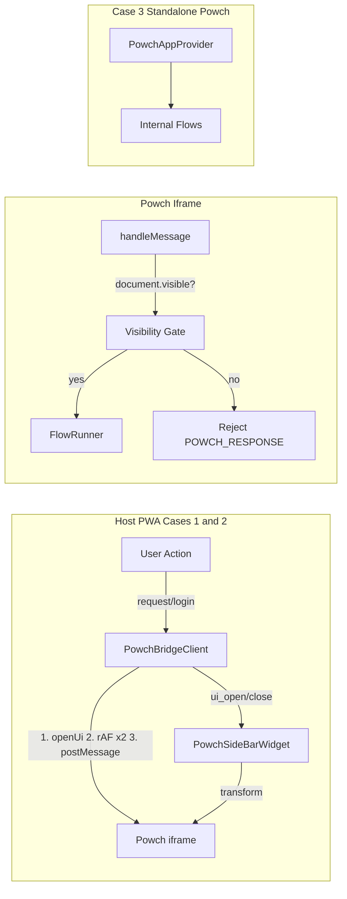

# Powch Developer Guide

**Audience:** Developers integrating or maintaining Powch in the DeSciX platform or third-party sites.

This guide describes the **as-built** architecture: the three deployment cases, the visibility paradigm, request flow routing, and integration paths.

---

## 1. Overview

Powch is a **zero-knowledge identity silo** — passkey-based authentication, email and wallet stored as encrypted cards. It operates in three modes:

- **One-touch crypto onboarding:** Passkey creation atomically derives the master wallet from PRF. The wallet pair is derived locally during the ceremony but is **withheld from `powch_register_finish`** and registered post-consent via `register_powch_wallet_address` iff the user granted `wallet_address` sharing (GUARDRAIL-2026-07-03-POWCH-CONSENT-INVERSION). Users land in CONNECTED after consent + email/TOS. See [prf-derived-master-wallet.md](./detailed/prf-derived-master-wallet.md).
- **Host mode (Cases 1 & 2):** Powch runs in an iframe; the host PWA owns the iframe and communicates via postMessage.
- **Standalone mode (Case 3):** Powch is the main app; no iframe, no sidebar, internal flows only.

For protocol details, see [powch-state-machine.md](./detailed/powch-state-machine.md). For flows and data model, see [architecture.md](./architecture.md) and [data-security-architecture.md](./data-security-architecture.md).

---

## 2. Three Deployment Cases

Aligned with [app-shell-enclosure.md](./detailed/app-shell-enclosure.md):

### Case 1 – descix.net (Platform)

- **App Shell identity:** DeSciX.
- Renders platform UI (store, lobby, codesite).
- Uses **PowchBridgeProvider** and **PowchBridgeClient** (PWA-owned).
- Embeds Powch in **PowchSideBarWidget** (iframe slides in from the right).
- Host calls `powch.request()`, `powch.login()`, etc. via `usePowch()` / `usePowchBridge()`.
- **Every bridge request** triggers `openUi()` before sending; sidebar opens; Powch processes.

### Case 2 – [someapp].descix.net (Standalone App)

- Same as Case 1: PowchBridgeProvider, PowchSideBarWidget.
- Shell embeds the target app in an iframe; sidebar is shown for auth/pay.
- Host requests go through PowchBridgeClient; same visibility paradigm applies.

### Case 3 – powch.descix.net (Identity Silo)

- **PowchAppProvider** mounted at PWA root (no bridge).
- **PowchSideBarWidget is not rendered** — main content is Powch.
- All flows are internal (AuthFlowController, WalletConnectFlowController, etc.).
- No host postMessage; visibility gate does not apply to internal flows.

---

## 3. Visibility Paradigm (As-Built)

### Host controls visibility

The host decides when to show or hide the Powch sidebar (standalone-vanilla pattern). Powch does not control host DOM.

### Open before send

- **All** bridge requests call `openUi()` before sending — no filtering by request type.
- After `openUi()`, the actual postMessage is deferred with a double `requestAnimationFrame` so the host can re-render and paint the sidebar first.
- PowchSideBarWidget subscribes to `ui_open`, `ui_close`, and `toggle_ui` for reactive visibility updates.

### Visibility gate (security)

Powch rejects host requests when its tab is not visible:

- In `handleMessage`, after validating the command, Powch checks `document.visibilityState === 'visible'`.
- If the tab is backgrounded, Powch sends `POWCH_RESPONSE { success: false, error: 'Powch UI not visible' }` and does not process the request.
- Applies to all commands in `ALLOWED_HOST_COMMANDS`.

---

## 4. Request Flow Routing

The `request(options)` method routes to either **POWCH_LOGIN** (AuthFlowController) or **POWCH_CONNECT_WALLET** (WalletConnectFlowController):

| Condition | Route |
|-----------|-------|
| `hasRegisterDeSciX` or `requiresIdentity` (require includes `verified_email` or `email`) | POWCH_LOGIN |
| `isWalletOnly` (signatureMessage, or require includes only wallet-related fields) | POWCH_CONNECT_WALLET |
| Else | POWCH_LOGIN |

**DeSciX sign-in** uses:

```javascript
powch.request({
  require: ['verified_email', 'wallet_address', 'wallet_signature'],
  purpose: 'Sign in to DeSciX',
});
```

Because `require` includes `verified_email`, this routes to **POWCH_LOGIN** (AuthFlowController) — full identity + wallet flow, not wallet-only.

### The `require` contract (deny-by-default — GUARDRAIL-2026-07-03-POWCH-CONSENT-INVERSION)

`require` is a **REQUEST list only**. It defaults to empty, and:

- **Empty/absent `require` ⇒ the host page receives the session only.** No consent prompt is shown because nothing is requested, and no PII field (email, wallet_address, wallet_signature, any tier field) is released to the host page.
- **Account creation is not a host share** (eabadir/Unkamon#68). Accepting the DeSciX ToS is the user's consent for DeSciX to hold the account, so `SUBMIT_TOS` always registers the master wallet (`register_powch_wallet_address`, address + EIP-191 signature) and sends the verified email to `descix_accept_tos`, whatever the host requested. A host asking for the session only can therefore create a new account. A missing verified email or master wallet fails the flow with that reason.
- **`require` can never suppress the prompt.** Requested PII fields without vault-stored consent always show ConsentView. The only silent pass-through is the user's own prior "Remember this choice" (`hasConsent(origin, require)`).
- **`require` can never force sharing.** Only the user's approval (live or remembered) releases a field; the user may approve a subset of the requested fields.
- **Every PII release to a host page passes `hasConsent(origin, field)`** — the FINISH release filter consumes the canonical `ConsentRules` field-group matchers. There are no side channels. This applies to the DeSciX platform itself as a host page: a DeSciX page that needs the email or wallet requests the sign-in trio like any other host.
- **Consumers degrade gracefully.** E.g. Stripe checkout omits `customer_email` when no consented email exists on the account (Stripe asks the user instead).

See [consent-pii-paradigm.md](./detailed/consent-pii-paradigm.md) for the canonical contract.

---

## 5. Communication Protocol

See [powch-state-machine.md](./detailed/powch-state-machine.md) for the full protocol.

**Origin is browser-authoritative:** Powch stamps the consent origin from the postMessage `event.origin` (GUARDRAIL-2026-07-03-POWCH-CONSENT-INVERSION). A host-supplied `payload.origin` is ignored — a host can never claim another origin's vault-stored consent. Hosts do not need to pass `origin`.

**Visibility gate error:** When the Powch tab is not visible, host requests are rejected with:

```json
{ "type": "POWCH_RESPONSE", "requestId": "...", "success": false, "error": "Powch UI not visible" }
```

---

## 6. Integration Paths

### DeSciX PWA (Cases 1 & 2)

- **PowchBridgeProvider** — creates PowchBridgeClient, provides it via context.
- **PowchBridgeClient** — PWA-owned postMessage client; calls `openUi()` before every send; double rAF deferred postMessage.
- **PowchSideBarWidget** — renders the iframe; registers with bridge via `POWCH_REGISTER_IFRAME`; subscribes to visibility events.

### Third-party (React)


- **usePowchBridge** — for hosts that own the iframe; provides postMessage bridge, open/close/toggle, state mirror.

---

### Powch's own App Shell (Case 3)

Powch runs inside its OWN App Shell instance: its site entry mounts `<AppShell appId="powch" standalone>` around PowchAppProvider and PowchStandaloneApp. At `powch.<env>.descix.net` as the top window that shell is the only one. As the sidebar (Cases 1 and 2) the host's shell frames this same Powch document cross-origin and talks to it only by postMessage; Powch never uses the host's shell. Powch requires its own shell to function.

**Required bridge:** Powch's own `window.DeSciX` must be present with at least:

- `call(command, params)` — API gateway for all network calls (powch_register_finish, powch_vault_get, etc.)
- `AppData` — session storage (sessionInfo, loginStatus)
- `AppContext.setAppEvent` — to signal LOGIN_SUCCESS and state changes

**Blocking check:** On `INITIALIZE`, PowchAppProvider asks `shellInitGate` whether it may initialize. The gate keys on whether `window.DeSciX` exists, never on its mode string: in the cross-origin sidebar the shell reports mode `embedded-no-bridge` and Powch must still initialize. If the bridge object is missing, Powch shows the error view and does not initialize:

```javascript
// PowchAppProvider.jsx, INITIALIZE
const gate = shellInitGate(window.DeSciX);   // ok when window.DeSciX exists, whatever its mode
if (!gate.ok) {
  PowchData.error = 'System Initialization Failed: App Shell bridge not established.';
  viewRouter({ flow: FLOW_STATES.ERROR });
  return;
}
```

**Network bridge:** All Powch network calls go through `window.DeSciX.call` (makeCommandRequestJSON), which hydrates sessionInfo from responses and enables powch_vault_put / powch_vault_get with NOT_AUTHENTICATED.

**Implication:** Powch cannot run without its own App Shell. That shell provides routing, session hydration, and the DeSciX API surface.

---

## 7. Architecture Diagram



---

## 8. Related Documentation

| Document | Description |
|----------|-------------|
| [architecture.md](./architecture.md) | SyncManager, FlowRunner, flow contract |
| [implementing-flows.md](./implementing-flows.md) | How to create and wire flow controllers |
| [powch-state-machine.md](./detailed/powch-state-machine.md) | Event types and call stack |
| [flow-controllers.md](./flow-controllers.md#authflowcontroller) | Auth flow states |
| [powch-flow-wallet-connect.md](./detailed/powch-flow-wallet-connect.md) | Wallet connect flow |
