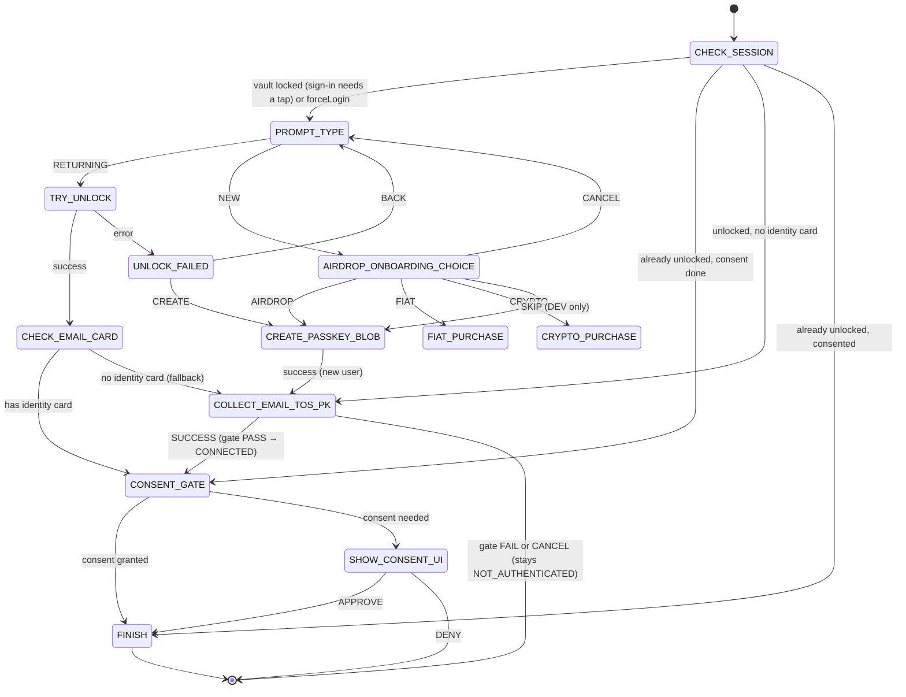
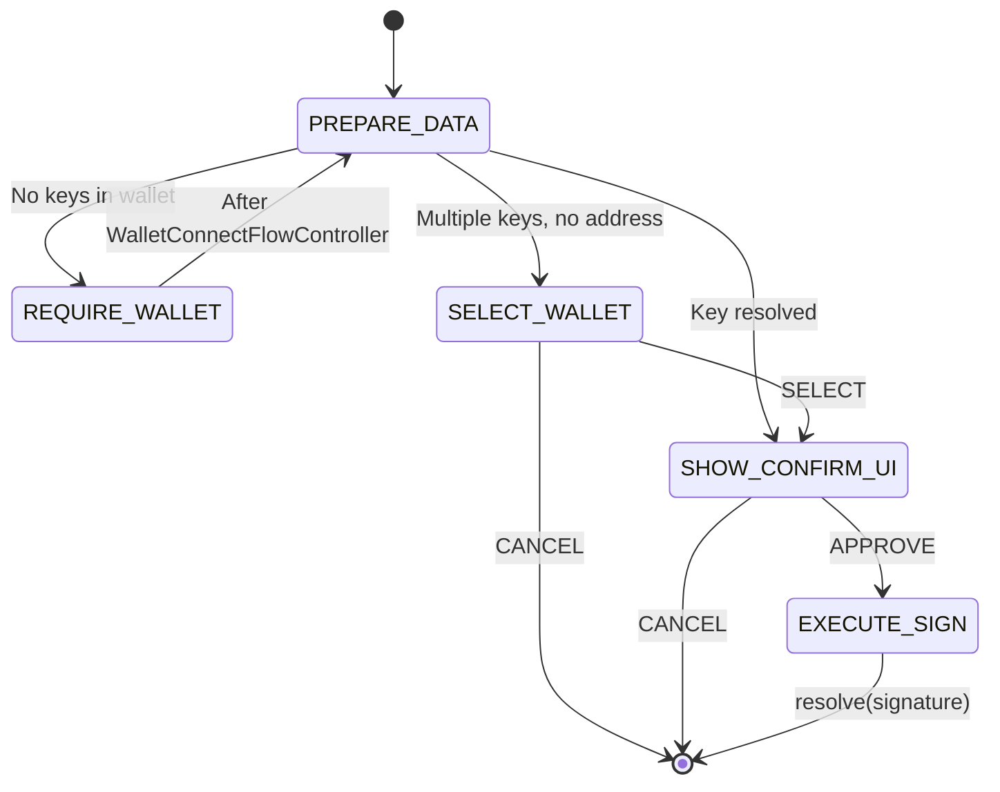
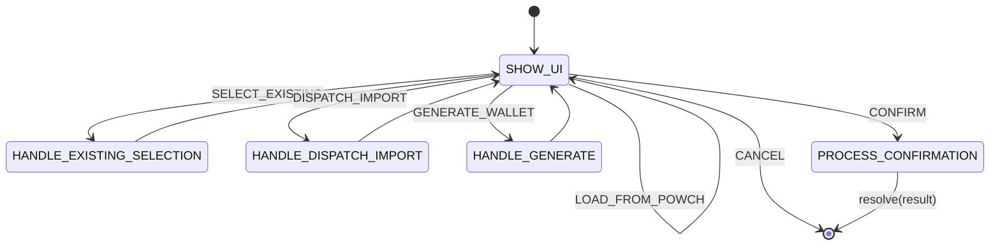

# Flow Controllers

Flow controllers are headless state machines that encapsulate business logic for multi-step user interactions. They are React-agnostic JavaScript classes that receive a context object with dependencies.

## BaseFlowController

**Location:** Powch's React layer, `BaseFlowController` module

All flow controllers extend BaseFlowController. **Default** `requirements = { vaultUnlocked: true }`; AuthFlowController overrides to `false`. **FlowRunner** checks before starting: if `vaultUnlocked` is true and the vault is locked (but credential exists), it shows the sign-in tap step (UnlockFlowController / UnlockPromptView) first; if the user cancels it the flow is rejected. See [architecture.md](./architecture.md).

### Context API

Flow controllers receive a context object from PowchAppProvider (built by FlowRunner):

| Method | Purpose |
|--------|---------|
| `completeRequestInternal(result)` | Complete the current request |
| `dispatchFlow(Controller, options)` | Start a nested flow |
| (data) | Flows call **PowchData.unlockWithOptions(options)** (sign-in tap only), **PowchData.createPasskeyBlobWithCachedOptions()** (New-account tap only), **PowchData.saveCards(cards, options)** for auth and persistence. No authService or powchClient.login in context. |

---

## AuthFlowController

**Location:** Powch's React layer, `AuthFlowController` module

Purpose: "Get ID Card for Site" — user identification, authentication (biometric), and data sharing consent. Triggered by `POWCH_LOGIN` or `POWCH_AUTH`. **requirements.vaultUnlocked:** false (this flow handles unlock/create itself).

> **Consent restructure (2026-07-03 — GUARDRAIL-2026-07-03-POWCH-CONSENT-INVERSION):**
> the new-user commit path is now `CREATE_PASSKEY_BLOB` (wallet pair DEFERRED — not sent
> with `powch_register_finish`) → `COLLECT_EMAIL_TOS_PK` (collect-only, no network) →
> `CONSENT_GATE` → **`SUBMIT_TOS`** (always: master wallet via
> `register_powch_wallet_address`, then `descix_accept_tos` with the verified email, whatever
> the host requested) → `ACQUIRE_ENTITLEMENT_CHOICE` / `FINISH`.
> Empty `require` ⇒ the host page receives the session only. The mermaid diagram below also predates
> WS-AUTH-STATE-PURGE (the pre-passkey AIRDROP_ONBOARDING_CHOICE is gone; the
> entitlement choice is post-connect). `AuthFlowController.js` is the source of truth;
> the affected state/event rows below have been updated.

### State Machine (restructured 2026-04-22 via T-FLOW-PASSKEY-FIRST)



### States

| State | Type | Description |
|-------|------|-------------|
| `CHECK_SESSION` | action | In a Continue-on-Powch window (`options.topLevelCreate`) → CREATE_ON_POWCH. With `options.signInOptions` (the locked vault's Unlock Vault tap in CardsHomeView took them; `PowchAppProvider` `unlockVault`; the lock screen holds them only while it is shown on screen in a visible document, `components/unlockVaultSignIn.js` + `useShownOnScreen`, so a closed sidebar or hidden tab issues no `powch_login_begin`) → TRY_UNLOCK with those options, no Returning/New choice; no credential known on this device → throws. If vault already unlocked: check identity card; go to FINISH, CONSENT_GATE, or COLLECT_EMAIL_TOS_PK. Else → PROMPT_TYPE (a stored credential too: sign-in starts only from a tap). |
| `PROMPT_TYPE` | UI | PowchMainView — returning vs new user. Entry prefetches the sign-in and registration options (ceremonyOptions.js); each button is disabled until its options load. NEW (and UNLOCK_FAILED CREATE) asks `core/createPlacement.js`: top level → CREATE_ON_POWCH (the create screen); a frame under a cross-origin host → the same tap opens the Powch window (`openTopLevelCreate`) → CREATE_AT_TOP_LEVEL, no create() in the frame. |
| `AIRDROP_ONBOARDING_CHOICE` | UI | OnboardingEntryChoice — airdrop / fiat / crypto / (optional SKIP in DEV). AIRDROP and SKIP both route directly to CREATE_PASSKEY_BLOB (passkey-first). |
| `FIAT_PURCHASE` | UI | FiatStubScreen (B1 stub) |
| `CRYPTO_PURCHASE` | UI | CryptoStubScreen: 'Crypto purchase is not available yet; buy with a card.' (no call) |
| `TRY_UNLOCK` | action | Entered only from a tap; PowchData.unlockWithOptions(options) with the prefetched options (get() is the first await); on success → CHECK_EMAIL_CARD; on error → UNLOCK_FAILED |
| `UNLOCK_FAILED` | UI | UnlockFailedView — the browser's own error, except a get() that returned no PRF output (`PasskeyNoWalletKeyError`), titled "This passkey cannot unlock a wallet" with the specific message; Try again (RETRY, disabled until fresh sign-in options load), Create New Account or Back. CREATE (disabled until registration options load) → as PROMPT_TYPE NEW |
| `CREATE_PASSKEY_BLOB` | action | PowchData.createPasskeyBlob with `deferWalletRegistration: true` (createOnTap: the registration options prefetched on screen entry; create() is the first await; not ready → fails loud, no refetch) — the derived wallet pair is stashed on `ctrl.data.pendingWallet`, NOT sent to the backend. On success for new-user path → COLLECT_EMAIL_TOS_PK. Entered in a framed document → throws naming the routing defect (no create() call); create() reported PRF but no output and the `get()` that asks the new passkey for it needs a new tap (`PasskeyPrfConfirmationNeededError`) → CONFIRM_PASSKEY_PRF; the passkey provider returned no PRF output (`PasskeyProviderRefusedError`, thrown before `powch_register_finish`) → PASSKEY_PROVIDER_REFUSED; any other failure → CREATE_FAILED |
| `CONFIRM_PASSKEY_PRF` | UI | ConfirmPasskeyPrfView — "Confirm your passkey once more to finish". CONFIRM → CONFIRM_PASSKEY_PRF_RUN; BACK → PROMPT_TYPE (CREATE_ON_POWCH in the Powch window). Nothing is registered yet. |
| `CONFIRM_PASSKEY_PRF_RUN` | action | `PowchData.confirmPasskeyPrfAndFinishCreate(pending)`: `get()` against the new passkey is the first await; its PRF output finishes the account → COLLECT_EMAIL_TOS_PK. No output → PASSKEY_PROVIDER_REFUSED; another failure → CONFIRM_PASSKEY_PRF with the browser's error. |
| `PASSKEY_PROVIDER_REFUSED` | UI | PasskeyProviderRefusedView — titled with the provider named from the refused passkey's AAGUID ("Chrome on Mac cannot protect a wallet"; an unknown AAGUID reads "Your passkey provider cannot protect a wallet" and shows the AAGUID): the measured reason (`prf-not-supported` or `prf-no-output`), the providers that can, nothing registered. CREATE_ANOTHER_WAY (disabled until fresh registration options load) → CREATE_PASSKEY_BLOB, with every refused credential id in `excludeCredentials` (createOnTap reads `ctrl.data.refusedCredentialIds`); BACK → PROMPT_TYPE, or CREATE_ON_POWCH in the Powch window, whose frame is not told of the refusal and keeps waiting. |
| `CREATE_AT_TOP_LEVEL` | UI | ContinueOnPowchView — New account in a frame under a cross-origin host opened this Powch page at the top level in a new window (`core/topLevelCreate.js` `openTopLevelCreate`, from the tap itself); this screen waits. TOP_LEVEL_CREATED carries the window's DeSciX session (and credential id): stored in this document's App Shell (`ctx.adoptSessionInfo`, `core/shellSession.js`: `loginWithSessionToken` + LOGIN_SUCCESS) → FINISH, which answers the host's request with it (no further tap; the vault here stays locked until a sign-in tap: the stored credential id makes the sidebar's lock screen read Unlock Vault, whose tap is that sign-in, CHECK_SESSION `signInOptions`). TOP_LEVEL_FAILED (the window's reason; it stays open), TOP_LEVEL_CLOSED, a CREATED report without a session and a refused open are shown; CONTINUE_ON_POWCH opens the window again. |
| `CREATE_ON_POWCH` | UI | CreateOnPowchView, the create screen, always at the top level: the top-level Powch page after NEW, or the Continue-on-Powch window (the user chose New account in the frame). It shows the backed-up-provider warning for this browser (`core/passkeyProviderCopy.js` `backedUpProviderWarning`, from the user agent and platform; a browser it cannot name gets the generic text) with an "I've read this" box: READ_BACKUP_WARNING `{ read }` sets `ctrl.data.backupWarningRead`, and Create your passkey is disabled, and CREATE refused by name, until it is ticked. CREATE → CREATE_PASSKEY_BLOB; in the Continue-on-Powch window the account then registers through SUBMIT_TOS → FINISH, and the window hands the session to the frame (`reportCreated`) and closes. CREATE_FAILED there reports its error (`reportFailed`), offers no sign-in, and BACK returns here. No Powch opener: a plain account creation, which says so. |
| `CHECK_EMAIL_CARD` | action | Returning-user branch: if identity card exists → CONSENT_GATE; else fallback to → COLLECT_EMAIL_TOS_PK |
| `COLLECT_EMAIL_TOS_PK` | UI | CollectEmailTosPkView — consolidated email + TOS. **Collect-only (no network):** stashes the payload on `ctrl.data.pendingTos` → CONSENT_GATE. |
| `CONSENT_GATE` | action | Decides the host-page share only. No PII requested → `consentedFields=[]` and continue; requested + `hasConsent(origin, require)` → silent continue; else → SHOW_CONSENT_UI. Continuation is SUBMIT_TOS when `pendingTos` exists, else ACQUIRE_ENTITLEMENT_CHOICE (new onboarding) / FINISH. |
| `SUBMIT_TOS` | action | Account commit, independent of `consentedFields` (accepting the DeSciX ToS is the user's consent for DeSciX to hold the account): `register_powch_wallet_address` with the master wallet address + signature (this session's pair, else re-derived from the held cloudKey), then `descix_accept_tos` with the verified email (any-token gate runs server-side). A missing verified email or master wallet rejects with that reason before any write. Gate PASS: MASTER_ID card + vault persist (local), → ACQUIRE_ENTITLEMENT_CHOICE / FINISH. Gate FAIL: reject — user stays NOT_AUTHENTICATED. |
| `SHOW_CONSENT_UI` | UI | ConsentView — approve or deny |
| `FINISH` | action | Result filtered by consented fields via canonical `ConsentRules` matchers; completeRequestInternal(result); resolve(result) |

### Events

| Event | Source | Effect |
|-------|--------|--------|
| `RETURNING` | PowchMainView | → TRY_UNLOCK |
| `NEW` | PowchMainView | top level → CREATE_ON_POWCH; a frame under a cross-origin host → opens the Powch window, CREATE_AT_TOP_LEVEL |
| `AIRDROP` | OnboardingEntryChoice | → CREATE_PASSKEY_BLOB |
| `FIAT` | OnboardingEntryChoice | → FIAT_PURCHASE |
| `CRYPTO` | OnboardingEntryChoice | → CRYPTO_PURCHASE |
| `SKIP` | OnboardingEntryChoice (DEV) | → CREATE_PASSKEY_BLOB |
| `CANCEL` | OnboardingEntryChoice | → PROMPT_TYPE |
| `RETRY` | UnlockFailedView | → TRY_UNLOCK |
| `CREATE` | UnlockFailedView | → as `NEW` |
| `READ_BACKUP_WARNING` | CreateOnPowchView | `{ read }` → `ctrl.data.backupWarningRead`; re-render |
| `CREATE` | CreateOnPowchView | → CREATE_PASSKEY_BLOB once the warning is marked read; before that, throws |
| `BACK` | UnlockFailedView | → PROMPT_TYPE |
| `SUCCESS` | CollectEmailTosPkView | Stash payload (email, tosAccepted) on `ctrl.data.pendingTos` — NO network call — → CONSENT_GATE. The server commit happens in SUBMIT_TOS after consent resolves. |
| `APPROVE` | ConsentView | Persist consent via setSiteSettings if rememberChoice → SUBMIT_TOS (pendingTos) / ACQUIRE_ENTITLEMENT_CHOICE / FINISH |
| `DENY` | ConsentView | Reject request |

### Removed states (T-FLOW-PASSKEY-FIRST Chunk 4)

- `VERIFY_AIRDROP_WALLET` — the pre-passkey TokenGateView preview is gone. The
  token gate now runs server-side inside `descix_accept_tos` on the submitted
  form, guaranteeing the user cannot reach CONNECTED without passing it.
- `COLLECT_EMAIL` (standalone) — merged into the consolidated `COLLECT_EMAIL_TOS_PK`.
| `APPROVE` | ConsentView | Persist consent via setSiteSettings if rememberChoice → FINISH |
| `DENY` | ConsentView | Reject request |

### Props (AuthFlowProps)

Use `AuthFlowProps.login(opts)` for internal calls; host payloads use `AuthFlowProps.from(payload)`.

| Field | Type | Description |
|-------|------|-------------|
| `origin` | string | Requesting site origin |
| `require` | string[] | Required data fields |
| `purpose` | string | Display purpose text |
| `brand` | object | Site branding |
| `forceLogin` | boolean | Skip silent login |

---

## SignFlowController

**Location:** Powch's React layer, `SignFlowController` module

Handles signing of Ethereum transactions, personal messages, or typed data. Triggered by `POWCH_SIGN`, `POWCH_SIGN_TX`, `POWCH_SIGN_MESSAGE`, or `POWCH_SIGN_TYPED_DATA`.

### State Machine

**requirements.vaultUnlocked:** true. FlowRunner unlocks the vault before this flow starts; no AUTH_REQUIRED state.



### States

| State | Type | Description |
|-------|------|-------------|
| `PREPARE_DATA` | action | **PowchData.resolveAddress(address)** → cardId, keyIndex; estimate gas. Vault is already unlocked by FlowRunner. |
| `REQUIRE_WALLET` | action | Dispatch WalletConnectFlowController as nested flow |
| `SELECT_WALLET` | UI | PowchTransactionFlow (select mode) |
| `SHOW_CONFIRM_UI` | UI | PowchTransactionFlow (confirm mode) |
| `EXECUTE_SIGN` | action | **PowchData.signTransaction(cardId, txData, makeRequest)** / **signMessage** / **signTypedData**; resolve(result) |

### Nested Flows

SignFlowController can dispatch WalletConnectFlowController when the user has no wallet keys. Auth is handled by FlowRunner pre-flight (vault unlock before the flow starts).

### Options

| Option | Type | Description |
|--------|------|-------------|
| `type` | string | 'transaction' \| 'message' \| 'typedData' |
| `tx` | object | Transaction object (for type='transaction') |
| `message` | string | Message to sign (for type='message') |
| `domain`, `types`, `value` | object | EIP-712 typed data (for type='typedData') |
| `address` | string | Specific address to sign with |
| `origin` | string | Requesting site origin |

---

## WalletConnectFlowController

**Location:** Powch's React layer, `WalletConnectFlowController` module

Handles wallet selection, import, generation, and optional message signing. Triggered by `POWCH_CONNECT_WALLET` or as a sub-flow from SignFlowController.

### State Machine

**requirements.vaultUnlocked:** true. FlowRunner unlocks the vault before this flow starts; no ACQUIRE_PRF state. LOAD_FROM_POWCH goes directly to SHOW_UI (vault already unlocked).



### States

| State | Type | Description |
|-------|------|-------------|
| `SHOW_UI` | UI | WalletConnectView - wallet selection/import UI |
| `HANDLE_EXISTING_SELECTION` | action | Set selected address from existing wallet |
| `HANDLE_DISPATCH_IMPORT` | action | Dispatch ImportFlowController as sub-flow; on resolve return to SHOW_UI |
| `HANDLE_GENERATE` | action | Generate new random wallet |
| `PROCESS_CONFIRMATION` | action | Sign message if needed; a new key → VAULT_SAVE_PROMPT (vault-save tap step), else resolve |

### Events

| Event | Source | Effect |
|-------|--------|--------|
| `SELECT_EXISTING` | WalletConnectView | → HANDLE_EXISTING_SELECTION |
| `DISPATCH_IMPORT` | WalletConnectView (Import from backup) | → HANDLE_DISPATCH_IMPORT (sub-flow to ImportFlowController) |
| `GENERATE_WALLET` | WalletConnectView | → HANDLE_GENERATE |
| `LOAD_FROM_POWCH` | WalletConnectView | → SHOW_UI (vault already unlocked by Runner) |
| `CONFIRM` | WalletConnectView | → PROCESS_CONFIRMATION |
| `CANCEL` | WalletConnectView | Reject request |

### Key Persistence

When a new key is imported or generated, the flow creates a CRYPTO_WALLET card and saves it from the vault-save tap step (vaultSaveStep.js: **PowchData.saveCards(cards, options)**, get() as the tap's first await). See [data-security-architecture.md](./data-security-architecture.md) for the single-entry-point and vaultOps pattern.

### Props (WalletConnectFlowProps)

**Strict enforcement:** FlowRunner requires Props instances from factories only. Use factories:

- `addWallet()` — View event (hamburger "New Wallet", Cards plus)
- `connect(opts)` — Host POWCH_CONNECT_WALLET; purpose 'connect' when no signatureMessage, 'sign' when present
- `sign(opts)` — SignFlow sub-flow (REQUIRE_WALLET)
- `selectOnly(opts)` — SignFlow when wallets exist

| Field | Type | Description |
|-------|------|-------------|
| `purpose` | string | 'add_wallet' \| 'sign' \| 'connect' |
| `signatureMessage` | string | Optional message to sign on connect |
| `startMode` | string | Initial mode ('import' \| 'create' \| null) |
| `instruction` | string | Display instruction text |
| `isRequirement` | boolean | True when called as sub-flow |

---

## ImportFlowController

**Location:** Powch's React layer, `ImportFlowController` module

Handles importing an existing private key. Used as a **standalone flow** (e.g. from hamburger) or as a **sub-flow** when the user selects "Import from backup" in WalletConnectView.

### Props (ImportFlowProps)

Factories: `standard()`, `fromKey({ privateKey, label })`; host uses `ImportFlowProps.from(payload)`.

### Key Operations

Import flow creates CRYPTO_WALLET cards and persists them in one write from the vault-save tap step. No addKey/commit; see [data-security-architecture.md](./data-security-architecture.md).

---

## PrintWalletFlowController

**Location:** Powch's React layer, `PrintWalletFlowController` module

"Print my wallet": the wallet sheet (the 24 words and the master private key as hex) in mode `review`, behind a passkey tap (**PowchData.printWalletSheet(options)**, get() first). Entry points: Portfolio, the menu, and Wallet Manager's Security tab (`openPrintWallet()`). Stores nothing on the server.

**Props (PrintWalletFlowProps):** Use `PrintWalletFlowProps.standard()`; no host invocation.

### State Machine

The one state comes from `flows/printWalletStep.js`, shared with AuthFlow's mandatory step:

- `START` (action): `PRINT_WALLET` at the top level; `PRINT_WALLET_AT_TOP_LEVEL` in a frame under a cross-origin host
- `PRINT_WALLET` (UI, PrintWalletView): events REVEAL (the tap; vault-write options prefetched on entry), MARK_PRINTED { confirmed }, CONTINUE (refused until "I have printed or written it down" is ticked; resolves), CANCEL (rejects)
- `PRINT_WALLET_AT_TOP_LEVEL` (UI, ContinueOnPowchView purpose review): CONTINUE_ON_POWCH opens the top-level Powch window with `powch_sheet=review`; TOP_LEVEL_CREATED stores the window's session and resolves; BACK rejects

---

## PaymentFlowController

**Location:** Powch's React layer, `PaymentFlowController` module

Handles payment flows. Currently stubbed for future implementation.

---

## Flow Lifecycle

### Starting a Flow

PowchAppProvider starts flows via **FlowRunner.runFlow(FlowClass, options, deps)**. FlowRunner shows the pre-flight sign-in tap step if the flow has `requirements.vaultUnlocked` and the vault is locked, then builds context and starts the flow. Flows call **PowchData.unlockWithOptions(options)**, **PowchData.createPasskeyBlobWithCachedOptions()**, **PowchData.saveCards(cards, options)**, **PowchData.signTransaction(cardId, ...)** etc. directly. See [architecture.md](./architecture.md).

### Completing a Flow

Flows complete by calling `completeRequestInternal(result)`:

```javascript
// In FINISH state
async execute() {
  if (this.state === 'FINISH') {
    const result = {
      email: this.data.email,
      wallet: PowchData._vault?.toJSON?.() ?? null,  // or result from login
      credentialId: PowchData.credentialId,
    };
    await this.context.completeRequestInternal(result);
  }
}
```

`completeRequestInternal` delegates to `PowchData.completeAuth(result)` which sets credentialId, updates appState, and clears flowData.

---

## Detailed Documentation

For implementing new flows, see [implementing-flows.md](./implementing-flows.md). For current architecture and ceremony detail, see [architecture.md](./architecture.md). For granular state-by-state documentation, see:
- [detailed/powch-flow-sign.md](./detailed/powch-flow-sign.md)
- [detailed/powch-flow-wallet-connect.md](./detailed/powch-flow-wallet-connect.md)
- [detailed/powch-flow-payment.md](./detailed/powch-flow-payment.md)
