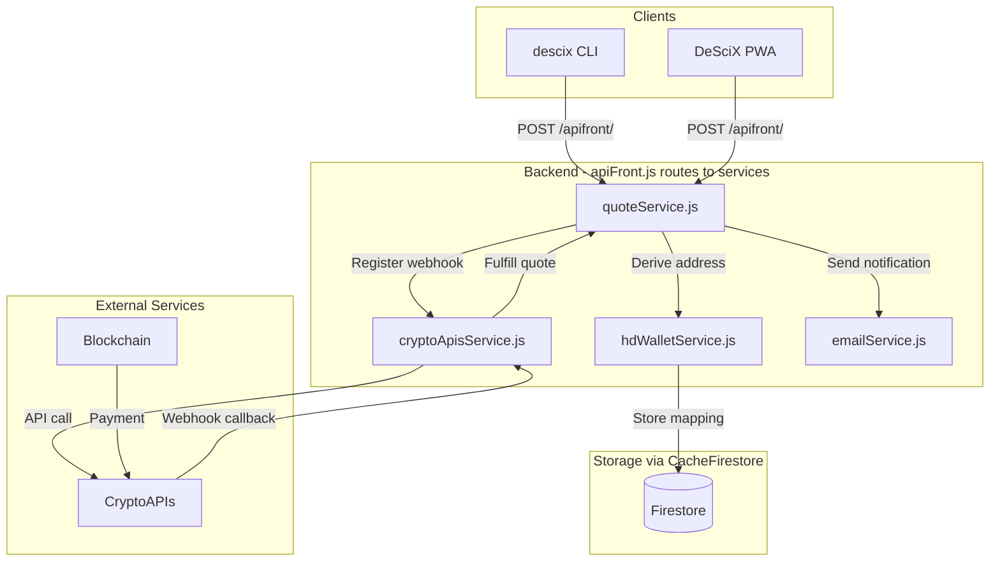
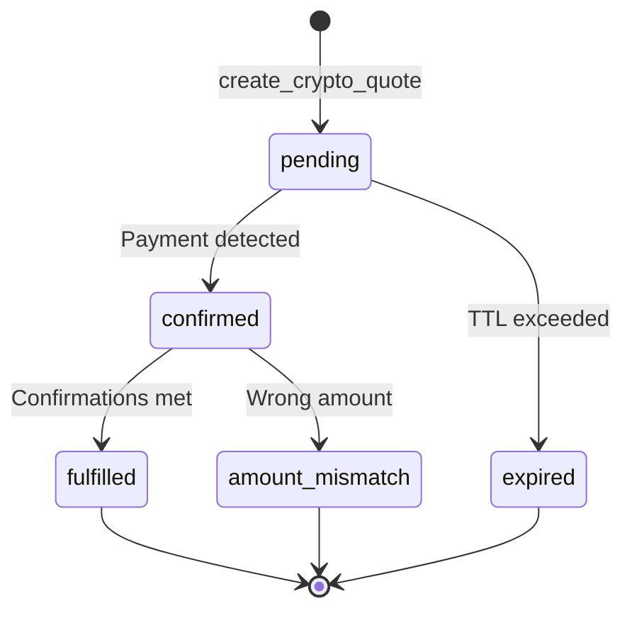

# Crypto Payments

> **V2 Paradigm**: DeSciX V2 uses a **pure DEX model**. The custodial USDCX balance has been removed. For app and token purchases, users pay with **USDC/USDT** directly from their wallet via **Powch**. The multi-chain quote system described below may still support **community token purchases** (e.g., MATIC/ETH/BNB → EGPT) via crypto deposits. See [Powch: DeFi Banking + SSO](../../architecture/powch-defi-sso.md).

DeSciX supports multi-chain cryptocurrency payments for purchasing community tokens. This document describes the quote-based crypto deposit architecture for token acquisitions.

## Overview

Users can pay with various cryptocurrencies to:
1. **Mint community tokens** (DAITA, EGPT, etc.) via crypto deposit quotes
2. *(V1 only, removed in V2)* ~~Credit USDCX to custodial balance~~

The system uses unique HD wallet addresses per quote to ensure unambiguous transaction matching.

## Supported Chains

| Chain | Asset | Status | Confirmations | Address Type |
|-------|-------|--------|---------------|--------------|
| Polygon | MATIC | ✅ Production | 32 | EVM (local derivation) |
| Ethereum | ETH | ✅ Production | 12 | EVM (local derivation) |
| BNB Chain | BNB | ✅ Production | 15 | EVM (local derivation) |
| Bitcoin | BTC | ✅ Production | 2 | UTXO (CryptoAPIs xpub) |
| Dogecoin | DOGE | ✅ Production | 6 | UTXO (CryptoAPIs xpub) |

## Architecture



## Quote Lifecycle



### Quote States

| State | Description |
|-------|-------------|
| `pending` | Quote created, waiting for payment |
| `confirmed` | Payment detected, waiting for confirmations |
| `fulfilled` | Payment confirmed, tokens credited |
| `expired` | Quote TTL exceeded without payment |
| `amount_mismatch` | Payment received but amount doesn't match |

## HD Wallet Address Derivation

Each quote receives a unique deposit address derived from a master seed phrase using BIP-44 derivation paths:

| Chain Type | Derivation Path | Library |
|------------|-----------------|---------|
| EVM (ETH, Polygon, BNB) | `m/44'/60'/0'/0/{index}` | ethers.js |
| Bitcoin | `m/84'/0'/0'/0/{index}` | CryptoAPIs API |
| Dogecoin | `m/44'/3'/0'/0/{index}` | CryptoAPIs API |

### Address-to-Quote Mapping

Addresses are stored in two Firestore collections:
- `HDAddressMapping`: Maps address → quote_id (hdWalletService)
- `CryptoAddresses`: Extended address metadata (cryptoApisService)

## Webhook Flow

1. When a quote is created, a webhook subscription is registered with CryptoAPIs
2. CryptoAPIs monitors the blockchain for transactions to the deposit address
3. When a transaction is confirmed, CryptoAPIs sends a POST to our callback URL
4. The callback handler:
   - Verifies the HMAC-SHA256 signature
   - Looks up the quote by address
   - Verifies the payment amount
   - Fulfills the quote (credits tokens)

### Webhook Endpoint

```
POST /api/cryptoapis/webhook
```

**Headers:**
- `x-signature`: HMAC-SHA256 signature of the payload

**Payload Structure:**
```json
{
  "apiVersion": "2024-12-12",
  "referenceId": "subscription-id",
  "idempotencyKey": "unique-key",
  "data": {
    "item": {
      "address": "0x...",
      "transactionId": "0x...",
      "amount": "1.5",
      "direction": "incoming"
    }
  }
}
```

## Configuration

### Required Secret Manager Keys

| Key | Description |
|-----|-------------|
| `HD_WALLET_MNEMONIC` | BIP-39 seed phrase for EVM address derivation |
| `CRYPTOAPIS_API_KEY` | CryptoAPIs authentication key |
| `APP_URL` | Base URL for webhook callbacks (e.g., `https://demo.descix.net`) |
| `BTC_XPUB` | Bitcoin extended public key (for UTXO address derivation) |
| `DOGE_XPUB` | Dogecoin extended public key (for UTXO address derivation) |

### Generating xpub Keys

For Bitcoin and Dogecoin support, generate extended public keys from your mnemonic:

```bash
cd DeSciX_Cloud
node scripts/admin/generateXpubs.js
```

This script derives xpub keys that can be safely stored in Secret Manager. The private keys never leave the local environment.

### CryptoAPIs Dashboard

1. **Verified Domains**: Add your callback domain (e.g., `demo.descix.net`)
2. **API Key**: Create an API key with Blockchain Events permissions

## CLI Commands

### Create a Quote

```bash
descix buy quote --amount 10 --chain polygon --type community_token --email user@example.com
```

**Options:**
- `--amount <usd>`: USD amount to purchase
- `--chain <chain>`: Blockchain to use (polygon, ethereum, bnb)
- `--type <type>`: Purchase type (community_token)
- `--email <email>`: Email for confirmation (guest mode)
- `--community <id>`: Community ID for token purchase

### Check Quote Status

```bash
descix buy status <quote_id>
```

### Poll for Status

```bash
descix buy poll <quote_id>
```

Polls with exponential backoff until the quote is fulfilled or expired.

### List Supported Chains

```bash
descix buy chains
```

## Testing

### Prerequisites

1. Signed in: `descix login`
2. The workspace pinned to the environment you want to exercise:
   ```bash
   descix config init --env dev        # or: descix config set-env dev
   ```
   A single invocation can also be redirected with the global `--env` / `--api-url` flags,
   placed before the subcommand.

### Manual E2E Test

**Every environment settles on Polygon mainnet — there is no testnet lane. A quote you fund
moves real value.**

1. Create a quote:
   ```bash
   descix buy quote --amount 1 --chain polygon --email <your email>
   ```

2. Note the deposit address and amount

3. Send the exact amount to the deposit address using your wallet

4. Monitor the quote status:
   ```bash
   descix buy poll <quote_id>
   ```

5. Wait for the status to change to `fulfilled`

## Service Files

| File | Purpose |
|------|---------|
| `quoteService.js` | Quote creation, status, fulfillment |
| `hdWalletService.js` | HD wallet address derivation |
| `cryptoApisService.js` | CryptoAPIs integration, webhooks |
| `cryptoApisSdkService.js` | SDK wrapper for type-safe API calls |

## API Commands

| Command | Description | Auth Required |
|---------|-------------|---------------|
| `create_crypto_quote` | Create a new payment quote | No (guest) |
| `get_quote_status` | Get quote status by ID | No (guest) |

## Error Handling

| Error | Cause | Resolution |
|-------|-------|------------|
| `APP_URL not configured` | Missing Secret Manager config | Add APP_URL to secrets |
| `HD_WALLET_MNEMONIC not configured` | Missing seed phrase | Add mnemonic to secrets |
| `Callback URL has not been verified` | Domain not verified in CryptoAPIs | Verify domain in dashboard |
| `Amount mismatch` | User sent wrong amount | Contact support for manual resolution |

## Related Documentation

- [Powch: DeFi Banking + SSO](../../architecture/powch-defi-sso.md) – V2 auth and wallet flows
- [IP-IPO Lifecycle](../../contracts/ip-ipo-lifecycle.md) – Token economics
