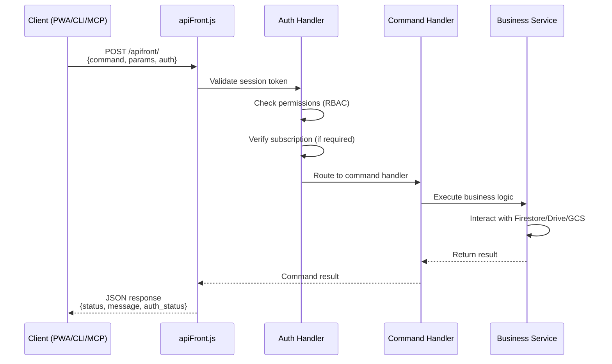

# DeSciX Backend

This directory contains the DeSciX backend API server, which provides the core platform functionality for all client applications (PWA, CLI, MCP, Discord Bot).

## Architecture Overview

The backend follows a **centralized command pattern** where all clients route through a single entry point:

```
All Clients → POST /apifront/ → apiFront.js → Business Services
```

**Key Principles**:
- **Single Entry Point**: All requests go through `apiFront.js` (no direct service access)
- **No Business Logic in Router**: `apiFront.js` only handles auth, permissions, and routing
- **HTTP-Only Clients**: CLI and MCP communicate exclusively via HTTP
- **No Duplication**: Services reuse existing abstractions (e.g., `googleStorageService.js` for all file ops)

## Key Components

Modules of the DeSciX Cloud service (not a published package):

- **`apiFront`** – Command router and paywall enforcement
- **`communityManagement`** – Community/App/KnowledgeBase CRUD
- **`purchase`** – Payment processing, role/product purchases
- **`geminiAPI`** – RAG orchestration and LLM integration
- **`pineconeService`** – Vector database operations
- **`googleStorageService`** – Unified Drive and GCS operations
- **`tokenService`** – On-chain token balance checks
- **`authHandlers`** – Authentication and user management
- **`ipStorageUtils`** – Data models (User, Community, App, KB, Role)

## Request Flow



## Documentation

- [API Reference](api-reference.md) – Complete command inventory
- [Services Architecture](services.md) – Service layer design and call stacks
- [RAG Pipeline](rag-pipeline.md) – Knowledge base vectorization and retrieval

## Related Documentation

- [Platform Architecture](../../architecture/index.md) – Overall platform architecture
- [Powch: DeFi Banking + SSO](../../architecture/powch-defi-sso.md) – Identity and auth flows
