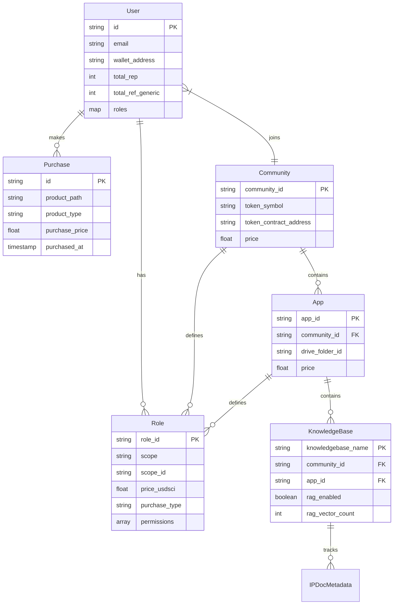

# Data Models

This document describes the core data models used throughout the DeSciX platform.

## User

```javascript
{
  id: "descix_{uuid}",              // Primary key
  email: "user@example.com",
  provider_links: Map<              // OAuth provider links
    "discord" | "google" | "descix" | "wallet",
    { provider_id, linked_at, provider_data }
  >,
  roles: Map<                        // Acquired roles
    "role_id",
    { acquired_date, expires_date? }
  >,
  total_rep: 0,                      // REP points
  total_ref_generic: 0,              // REF points
  accumulated_ref_commission: 0,      // Guild commissions
  wallet_address: "0x...",          // Connected wallet address (via Powch)
  base_folder_id: "abc...",         // Registered Drive folder ID
  // ... other fields
}
```

**Key Fields:**
- `id`: DeSciX primary identity (`descix_{uuid}`)
- `provider_links`: Map of OAuth provider connections (Powch is primary)
- `roles`: Map of acquired roles with expiry dates
- `total_rep`, `total_ref_generic`: Gamification points
- `wallet_address`: User's wallet (via Powch); payments use USDC/USDT from wallet
- `base_folder_id`: Registered Google Drive base folder for app creation

## Community

```javascript
{
  community_id: "egpt",
  community_name: "EGPT",
  token_symbol: "EGPT",
  token_contract_address: "0x...",
  ref_reward_rate: 0.1,              // REF reward rate
  guild_ref_commission_rate: 0.05,   // Guild commission rate
  price: 0,                          // Purchase price (0 = free)
  default_app_id: "agent",           // Auto-granted app on purchase
  is_public: true,                   // Public visibility
  icon_url: "gs://...",              // Community icon
  // ... other fields
}
```

**Key Fields:**
- `community_id`: Unique identifier
- `token_symbol`: ERC20 token symbol
- `token_contract_address`: On-chain contract address
- `default_app_id`: App automatically granted on community purchase

## App

```javascript
{
  community_id: "egpt",
  app_id: "periodic",
  app_name: "Periodic",
  drive_folder_id: "abc123...",      // Google Drive folder
  price: 0,                          // Purchase price (0 = free)
  token_symbol: "EGPT",              // Community token
  icon_url: "gs://...",              // App icon
  // ... other fields
}
```

**Key Fields:**
- `community_id`: Parent community
- `app_id`: Unique identifier within community
- `drive_folder_id`: Google Drive folder for app files
- `price`: Purchase price (paid from wallet via Powch)

## KnowledgeBase

```javascript
{
  community_id: "egpt",
  app_id: "periodic",
  knowledgebase_name: "General",
  drive_folder_id: "xyz789...",      // KB subfolder in Drive
  rag_enabled: true,                 // RAG vectorization enabled
  rag_vector_count: 1500,            // Number of vectors
  rag_last_sync: Timestamp,          // Last sync timestamp
  system_instructions: "...",        // LLM system prompt
  cache_model_name: "gemini-1.5-flash", // LLM model
  is_private: false,                 // Private KB flag
  owner_id: "descix_uuid",           // KB owner (for private KBs)
  // ... other fields
}
```

**Key Fields:**
- `rag_enabled`: Whether RAG vectorization is active
- `rag_vector_count`: Number of vector chunks in Pinecone
- `system_instructions`: LLM system prompt for chat
- `is_private`: Private KBs require owner access

## Purchase

Purchase records track user acquisitions of communities, apps, and roles. Stored in `UserCache/{user_id}/Purchases/{purchase_id}`.

```javascript
{
  PurchaseId: "guid",                // Unique purchase identifier
  ProductPath: "Community/egpt" | "Community/egpt/App/periodic" | "Role/platform_descix_member",
  ProductType: "COMMUNITY" | "APP" | "ROLE",
  ProjectToken: "EGPT",              // Community token symbol
  PurchasePrice: 0.0,                // Amount paid (0 for free)
  PurchasedAt: Timestamp,            // Purchase timestamp
  UserId: "descix_uuid",             // DeSciX user ID
  Currency: "USDC" | "USDT"          // Paid from wallet via Powch
}
```

**Purchase Path Format:**
- Communities: `Community/{community_id}`
- Apps: `Community/{community_id}/App/{app_id}`
- Roles: `Role/{scope}/{scope_id}/{role_id}` (e.g., `Role/PLATFORM/descix/platform_descix_member`)

**Default App Auto-Grant**: When a user purchases a community, if the community has a `default_app_id`, a corresponding Purchase record is automatically created for the default app at no additional cost.

## Role

```javascript
{
  role_id: "platform_descix_admin" | "community_egpt_developer" | "app_egpt/periodic_premium",
  role_name: "Admin" | "Developer" | "Premium",
  scope: "PLATFORM" | "COMMUNITY" | "APP",
  scope_id: "descix" | "egpt" | "egpt/periodic",
  permissions: ["PLATFORM_MANAGE_COMMUNITIES", ...],
  price_usdsci: 0.0,                // Cost (0 = free); paid from wallet
  purchase_type: "ONE_TIME" | "SUBSCRIPTION",
  billing_period: "monthly" | "yearly" | null,
  display_metadata: {
    icon: "...",
    category: "...",
    description: "..."
  }
}
```

**Role ID Naming Convention:**
- Platform: `platform_{platform_id}_{role_name}`
- Community: `community_{community_id}_{role_name}`
- App: `app_{community_id}/{app_id}_{role_name}`

## IPDocMetadata

Document-level metadata stored in Firestore `IPDocs/{file_id}` collection:

```javascript
{
  file_id: "abc123...",              // Google Drive file ID
  name: "document.pdf",              // File name
  community_id: "egpt",
  app_id: "periodic",
  knowledgebase_name: "General",
  gcs_uri: "gs://bucket/...",       // GCS path to full document
  chunk_count: 150,                  // Number of chunks
  is_synced: true,                   // Sync status
  last_synced: Timestamp             // Last sync timestamp
}
```

**Purpose**: Tracks document sync state, chunk counts, and GCS URIs. Chunk text itself is stored in Pinecone, not Firestore.

## Data Model Relationships



## Related Documentation

- [Platform Architecture](../architecture/index.md) – Overall platform architecture
- [Powch: DeFi Banking + SSO](../architecture/powch-defi-sso.md) – Identity and auth flows
- [Cloud Services](cloud/index.md) – Backend API and services
