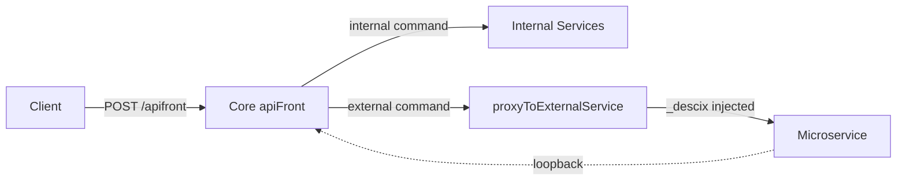

# Service Mesh and Proxying

This document describes the as-built service mesh: command routing via Core, HTTP proxying in local dev, and production routing via the GCP load balancer.

## Federated MCP Service Mesh

DeSciX employs a **Federated MCP Service Mesh**. Core (`DeSciX_Cloud`) acts as the **Federated Broker**—aggregating tools from all registered microservices into a unified catalog. Microservices self-register manifests; Core routes requests and validates session before proxying.

**Key principles:**
- **Service Zero:** Core is both a privileged microservice and the Gateway
- **Dynamic Discovery:** Services register manifests; Core exposes tools via `/mcp`
- **Tool Provider Model:** Microservices are "MCP-native" – they expose tools with `inputSchema`, not isolated REST endpoints

## Command Routing (via Core)

Core (`apiFront.js`) is the **command broker**. Commands sent via `makeCommandRequestJSON` go to `/apifront`. Core executes internal commands or proxies external commands to microservices per the Firestore manifest.

### Manifest Registration

- Microservices call `registerServiceManifest` to push their manifest to Firestore
- Core loads manifests via `loadServiceManifests`, `isExternalCommand`, `proxyToExternalService`
- **SERVICE_README:** Create `SERVICE_README_{service_name}.md` in your app's Drive folder; it is vectorized for `tell_me_how` semantic discovery
- Reference: `DeSciX_Core/descix-cloud-core/src/serviceManifest.js`, `DeSciX_Cloud/services/serviceManifestManager.js`

### _descix Context Propagation

Core injects a `_descix` context object into the request body before proxying:

```json
{
  "original_params": "...",
  "_descix": {
    "user_id": "...",
    "entitlements": ["app_1", "community_2"],
    "session_valid": true
  }
}
```

**Microservices trust only the signed `_descix`** — the platform door signs it with the env's mesh key and the service verifies it locally in-process via `mountMeshApi` from `@descix/cloud-core` (no session re-validation, no blockchain call, no callback to the platform at request time). A service never trusts an unsigned `_descix` and never dispatches for a caller with no credential (`401 MESH_CTX_MISSING`). See [`../architecture/mesh-trust-model.md`](../architecture/mesh-trust-model.md).

### Loopback Pattern

Microservices can call back into Core (or other services) to leverage shared capabilities (RAG, auth) using the same MCP protocol via `mcpClient.callTool()`.

### Flow



## HTTP Proxying (Local Dev)

**Local dev uses descix-serve**, not Core as an HTTP gateway. The `createViteProxyConfig` (from `@descix/app-sdk/dev`) routes:

| Path | Target |
|------|--------|
| `/apifront`, `/api`, `/mcp` | Core (env.apiUrl) |
| `/powch` | Powch PWA |
| `/s/{community}/{appId}` | Microservice localhost:{service.port} |

Ports come from `.descix/workspace.json` (`communities.{c}.apps.{a}.service.port`). Core does not proxy HTTP in dev; descix-serve handles it.

**Dev startup:** Core first (`DEBUG_LOCAL=true`), then microservices. Services use `DeSciX_ServiceSDK`; on startup they register with Core and receive a dynamic port assignment.

## Production: Broker-First Routing

**In production, sites call `/apifront` on their host (or env apex).** The edge routes `/apifront` and `/mcp` to the shared broker (`apiFront-http-{env}`), and `/api/*` on an app host straight to that app's Cloud Run service `{app}-{env}` by name. Core validates entitlements and proxies to microservices via Firestore manifest dispatch for the canonical SDK path — this is the platform-hosted dispatch path, not a metering point for an app's own inbound `/api` traffic (the app owner meters those users in-service; [`../architecture/mesh-trust-model.md`](../architecture/mesh-trust-model.md)).

Platform LB is provisioned at standup by `deploy-backend-env.sh` → `provision-platform-lb.js`. See [`../architecture/platform-must-know-briefer.md`](../architecture/platform-must-know-briefer.md) §3.

## Summary

| Context | Command routing | HTTP / LB |
|---------|-----------------|-------------|
| Local | Client → /apifront → Core → internal or proxy to microservice | descix-serve proxies /apifront, /api, /mcp to Core |
| Production | Client → /apifront → Core → internal or proxy | Static url-map: site → GCS; apex /apifront → daita broker NEG; powch /api → powch NEG |

## Related

- [mcp-mesh](mcp-mesh.md) – tell_me_how, tool discovery
- [mesh-trust-model](../architecture/mesh-trust-model.md) – call directions, metering ownership, signed caller identity
- [api-and-command-routing](api-and-command-routing.md)
- [descix-serve-gateway](../architecture/descix-serve-gateway.md)

## Cloud → Powch Loopback

Powch → Cloud runs via the `CORE_API_URL` config (Powch calling
`get_platform_holdings` on Cloud during onboarding).

The reverse direction: `airdrop_execute_queue` in Cloud's
`airdropCommands.js` proxies `powch_broadcast_batch_update_balances` back to
Powch via `proxyToExternalService()` once the on-chain broadcast boundary is
lifted. Until then the handler exits at `stopped_at_broadcast_boundary`.

Both directions use the same service-account OIDC gate
(`serviceAccountOnly: true`) — only the Cloud Scheduler service account
(`CLOUD_SCHEDULER_SA`) may cross the loopback.

### Per-service lazy manifest TTL (T20b)

See [`api-and-command-routing.md`](api-and-command-routing.md) for the details.
The key invariant for the service mesh: a new microservice (or a new command
on an existing one) that publishes its manifest to Firestore after Cloud has
already booted is picked up on the next dispatch miss, without a Cloud
restart. Frequently-called services refresh implicitly; idle services
refresh lazily on the first dispatch that targets them.
